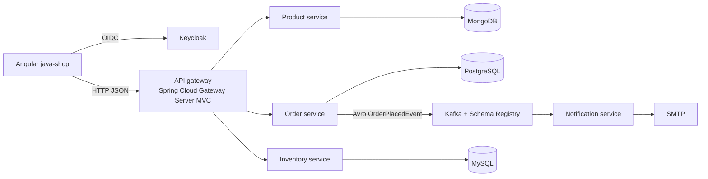

# Micro-Commerce

  

<strong>🚀 🟥 Micro-Commerce 🟥 🚀</strong>

  <strong>E-Commerce Microservice with Java Spring, Angular and Kubernetes</strong>

  
  
  

> **[Blocked] Documentation boundary:** this repository is documented as a brownfield learning/demo system, not as a production-ready commerce platform. The source baseline is branch `feature/kubernetes` at HEAD `b3dafa4416ca12a90ae7cfd5249b166c42321799` (`b3dafa4`), dated 2025-01-17. This README and `docs/**` are current uncommitted working-tree documentation changes. Analysis date: **2026-09-01**. No commands, builds, tests, containers, or network calls were run for this documentation pass.

*Existing architecture image preserved from the original README. The Mermaid diagram in [Architecture](docs/architecture.md) is the maintainable text representation.*

## Overview

Micro-Commerce is a small shop slice built from five backend Spring Boot applications in total: one servlet-based Spring Cloud Gateway Server MVC application and four domain services (product, order, inventory, and notification). It also contains two Angular applications, local Docker Compose definitions, and Kubernetes/Kind manifests.

**[Inferred] Intended user journey:** authenticate with Keycloak, browse a minimal catalog, submit a single-SKU order, check inventory synchronously, persist the order, publish an Avro event through Kafka, and send a confirmation email through SMTP.

> **Discovery note:** the pre-pass/baseline README claimed Eureka as a service-discovery component. No Eureka implementation was evidenced in the inspected snapshot. Fixed service URLs and Kubernetes DNS names appear instead; this documentation does not claim that Eureka is implemented.

## Status and maturity

| Area | Status | Evidence-led summary |
|---|---|---|
| Catalog | Partial | Product create/list endpoint declarations and catalog UI source are present; the UI was not exercised in this pass. |
| Ordering | Partial | One order endpoint checks availability, stores an order, and returns confirmation text. |
| Inventory | Partial | Availability is read-only; no reservation or decrement endpoint was found. |
| Notifications | Partial | Kafka consumer formats and sends an order confirmation email. |
| Authentication | Partial | OIDC frontend configuration and gateway JWT resource-server configuration are declared; effective downstream authorization is not established. |
| Local topology | Unverified | Root Compose declares the stack, but ports, variables, images, and dependencies drift across files. |
| Kubernetes | Blocked | Manifests and Kind scripts exist, but static schema/configuration blockers require reconciliation. |
| Quality gate | Blocked | Historical reports include failures; numeric coverage and an 80% gate are unavailable. |
| Production readiness | Blocked | Security, consistency, resilience, operations, recovery, and runtime evidence are incomplete. |

## Evidence legend

- **[Verified]**: directly visible in inspected source, configuration, test, or generated report. This label describes static evidence and does not mean runtime success.
- **[Inferred]**: interpretation derived from verified artifacts; not an explicit requirement.
- **[Unverified]**: declared by repository artifacts but not checked at runtime.
- **[Blocked]**: evidence or a prerequisite prevents a reliable conclusion or execution claim.

## Capabilities at a glance

| Capability | Current implementation | Main source |
|---|---|---|
| Product catalog | Create and list products backed by MongoDB | `product-service/product-service/src/main/java/com/js/microservices/product_service/application/controller/ProductController.java` |
| Order placement | Single SKU, client-supplied price/quantity/user details, PostgreSQL persistence | `order-service/src/main/java/com/js/microservices/order_service/application/service/OrderServiceImpl.java` |
| Stock check | Boolean availability query against MySQL | `inventory-service/inventory-service/src/main/java/com/js/microservices/inventory_service/application/controller/InventoryController.java` |
| Async event | Avro `OrderPlacedEvent` with four string fields | `order-service/src/main/resources/avro/order-placed.avsc` |
| Email notification | Kafka consumer and HTML SMTP mail | `notification-service/src/main/java/com/js/microservices/notification/application/consumer/kafka/KafkaOrderConsumer.java` |
| Authentication | Keycloak/OIDC browser flow and gateway JWT resource server | `frontend/java-shop/src/app/auth/auth.config.ts`, `api-gateway/src/main/java/com/js/gateway/infra/security/SecurityConfig.java` |
| Gateway resilience | Gateway forwarding and API-doc routes declare circuit-breaker filters; source declares `GET /fallback` with status 503; route retries and runtime fallback handling are not evidenced | `api-gateway/src/main/java/com/js/gateway/infra/Router.java` |
| Order-to-inventory resilience | The inventory client has separate `@CircuitBreaker` and `@Retry` declarations with a `false` fallback | `order-service/src/main/java/com/js/microservices/order_service/domain/gateway/InventoryGateway.kt` |
| Observability | Actuator, Prometheus, Loki, Tempo, Grafana declarations | `docker/`, service POMs, `k8s/manifest/infraestructure/observability/` |

## Architecture at a glance

**Text equivalent:** the primary Angular app calls Keycloak for identity and the gateway for product/order/inventory APIs. The gateway forwards to three HTTP domain services—product, order, and inventory. The fourth domain service, notification, consumes the order event. Product, order, and inventory own separate MongoDB, PostgreSQL, and MySQL persistence respectively. Orders publish an Avro event to Kafka; notification sends SMTP mail.

## End-to-end flow

1. The browser starts the OIDC authorization-code flow with Keycloak.
2. The primary Angular app obtains user data and access-token state.
3. Its HTTP services call gateway URLs from `frontend/java-shop/src/environments/`.
4. The gateway security configuration declares JWT authentication for protected paths and routes product, order, and inventory requests.
5. The order service calls inventory with `skuCode` and `quantity`.
6. If inventory returns `true`, the order service calculates `price × quantity`, saves `t_orders`, and sends `OrderPlacedEvent`.
7. The notification service consumes the event and sends an HTML confirmation email.

**Source-level reading:** the sequence above is derived from the inspected implementation and configuration. **Runtime status:** [Unverified]; no request, event, email, or browser journey was executed.

## Service map

| Backend application | Port declarations and topology evidence | Storage or dependency | Responsibility |
|---|---|---|---|
| API gateway | App/Dockerfile declare `9000`; root Compose maps host `9000` to container `8080`; `.env.gateway` also supplies `SERVER_PORT=8080` | Product, order, inventory, Keycloak | Entry point, routing, JWT resource-server configuration, CORS, source-declared `GET /fallback` |
| Product service | App uses `SERVER_PORT`; Dockerfile and root Compose use `8080` | MongoDB | Product create/list |
| Order service | App/Dockerfile declare `8081`; root Compose maps `8081:8081`; `.env.order` and `.env.order.example` set `SERVER_PORT=8080`, and other Compose files map `8081:8080` | PostgreSQL, inventory HTTP, Kafka/Schema Registry | Inventory check, order persistence, event publication |
| Inventory service | App, Dockerfile, and Kubernetes Service target `8082`; root Compose maps host `8082` to container `8080`; `.env.gateway` and its example supply `SERVER_PORT=8080` for the shared Compose environment | MySQL | Stock availability query |
| Notification service | `NOTIFICATION_SERVICE_PORT`; Dockerfile exposes `8083` | Kafka, SMTP | Order event consumption and confirmation mail |
| `frontend/java-shop` | Docker image serves on port `80`; root Compose maps host `4200` | Keycloak, gateway | Functional Angular UI |
| `frontend/java-shop-website` | SSR server defaults to `4000` in `server.ts` | Node/Express | Angular SSR scaffold/placeholder |

**Port and topology note:** environment overrides can change the effective Spring port, and Compose mappings describe host-to-container forwarding rather than an application listener. The root Compose, service-level Compose files, and Kubernetes manifests are not interchangeable runbooks. Compare the exact declarations in [Configuration](docs/configuration.md) and [Operations](docs/operations.md) before starting anything.

## Frontend choices

### Primary application: `frontend/java-shop`

This standalone Angular application has home and add-product routes, a product list, product creation form, order submission, and OIDC login/logout. It also contains an authorization interceptor, but static inspection shows that it subscribes to `getAccessToken()` asynchronously, calls `next(req)` immediately outside the subscription, and calls `next(...)` again inside it. The interceptor does not return the token-bearing request from the subscription, so duplicate requests are possible and effective authorization-header forwarding is unverified. Treat it as a static effectiveness defect, not as a proven authorization-header control. Its environment files route calls through the gateway.

### SSR scaffold: `frontend/java-shop-website`

This is a separate Angular SSR scaffold with `@angular/ssr`, Express, server entry points, and an empty route array. Its root component still contains generated placeholder content and placeholder OIDC settings. Do not describe it as the primary shop frontend.

## API entry points

- `GET /api/v1/products`: list products.
- `POST /api/v1/products`: create a product; source applies validation and returns `201`.
- `POST /api/v1/orders`: place one order; source returns `201` confirmation text or `422` for `InsufficientStockException`.
- `GET /api/v1/inventory?skuCode=...&quantity=...`: return a boolean availability result.
- `/aggregate/{service}/v3/api-docs`: gateway aggregate OpenAPI routes for product, order, and inventory.
- `/api-docs` and `/api-docs/ui.html`: Springdoc paths supported by the inspected dependency, controller, and configuration evidence for the gateway, product, order, and inventory applications. Notification has no REST controller or Springdoc evidence.

See the detailed [services and API reference](docs/services-and-api.md). Runtime status codes and error payloads were not exercised.

## Prerequisites and quick-start paths

### Prerequisites

The repository declares Java 21, Maven Wrapper, Node/npm for Angular, Docker for Compose and Testcontainers, and Kind/kubectl for the Kubernetes preview. Review the exact service POMs, frontend `package.json` files, Dockerfiles, and Kind scripts before setup.

### Local Compose: preview only

The root `docker-compose.yaml` declares a local topology, but no canonical start command appears in the original project documentation. The topology also contains default-sensitive values, mutable images, broad host-port publication, and cross-service environment-file reuse. Its port and environment assumptions are not interchangeable with the service-level Compose files or Kubernetes manifests.

**[Unverified] Do not treat the following as a successful runbook:**

1. Review the root Compose file and matching `.env.*.example` files.
2. Supply values through ignored local files or an approved secret mechanism.
3. Reconcile ports, URLs, databases, Kafka listeners, Keycloak realm, and SMTP settings.
4. Run only in an isolated development environment after resolving the blockers in [Configuration](docs/configuration.md).

### Kubernetes/Kind: blocked preview

`k8s/kind/create-kind-cluster.sh` declares `kind create cluster --name java-shop --config kind-config.yaml` and then recursively applies `k8s/manifest/`. The image-loading step is commented out, and the manifests contain port, schema, secret, realm, image, and database inconsistencies.

**[Blocked]** No Kubernetes execution or manifest validation was performed. See [Operations](docs/operations.md) before attempting it.

## Configuration and secrets warning

Do not copy values from `.env`, `.env.*.example`, realm exports, Kubernetes Secret manifests, or application YAML into tickets or public documentation. The repository contains development defaults, hardcoded database credentials, encoded/default Kubernetes values, wildcard origins, and anonymous Grafana settings.

Use [Configuration](docs/configuration.md) for variable names and ownership only. Use [Security](docs/security.md) for remediation priorities.

## Test and quality status

**[Blocked] No current verification run is claimed.** The ignored/untracked report files under `target/surefire-reports/` were inspected where present in the working tree as historical/generated artifacts. They are not durable evidence in a clean clone or a CI artifact, and their values are not current execution results. They record:

- Inventory initialization error because no valid Docker environment was found.
- Product context-load errors because `LOKI_URL` was unresolved.
- Order context-load errors because the Loki URI had an undefined scheme.
- Notification context test recorded one test without failures/errors, but this does not cover Kafka or SMTP delivery.

The inventory workflow has malformed `jobs`/`steps` nesting, and its standalone `cd` step cannot change the working directory of later workflow steps. The analogous order workflow also uses a standalone `cd`; these workflow files are declarations, not proof of a functioning quality gate. The repository contains no defensible numeric coverage result or project-wide 80% gate. See [Testing and quality](docs/testing-and-quality.md).

## Documentation index

| Page | Purpose |
|---|---|
| [Documentation hub](docs/index.md) | Audience-based reading paths and evidence rules |
| [Architecture](docs/architecture.md) | Context/container/component views, flows, boundaries, and drift |
| [Services and API](docs/services-and-api.md) | Controllers, payloads, routes, events, and unknown behavior |
| [Development](docs/development.md) | Layout, toolchains, evidenced commands, and troubleshooting |
| [Configuration](docs/configuration.md) | Variable ownership, profiles, Compose/Kubernetes drift, and secret hygiene |
| [Testing and quality](docs/testing-and-quality.md) | Test inventory, historical reports, risk matrix, and release gates |
| [Security](docs/security.md) | Threat surface, controls, static risks, and validation plan |
| [Operations](docs/operations.md) | Topology, images, ports, health, deployment gaps, and operator checklist |
| [Roadmap](docs/roadmap.md) | Evidence-derived epics and proposed acceptance criteria |
| [Evidence appendix](docs/evidence.md) | Claim provenance, asset preservation, and analysis limits |

Generated `HELP.md` files are optional Spring Initializr-style references. They are ignored/untracked and absent from a clean checkout unless regenerated; they are not required for this documentation set. The two frontend READMEs remain separate and untouched.

## Additional Documentation (main branch)

The merge from `origin/main` added a second documentation set under `docs/`, preserved alongside the validated flat pages above:

- [Consolidated analysis (main)](docs/analysis/ANALYSIS_CONSOLIDATED.md)
- [Documentation index (main)](docs/analysis/DOCUMENTATION_INDEX.md)
- [Architecture documentation (main)](docs/architecture/) — includes ADR-001 through ADR-009 under [docs/architecture/adrs/](docs/architecture/adrs/)
- [Testing strategy (main)](docs/TESTING-STRATEGY.md)

## Contribution and documentation rules

- Describe the repository as it exists; label proposals as proposals.
- Keep source/configuration paths in claims so maintainers can verify them.
- Update API, event, configuration, architecture, and operations pages when their evidence changes.
- Never commit live credentials, tokens, client secrets, or copied realm/Secret values.
- Do not edit generated Avro classes directly.
- Preserve existing image/media references unless an intentional, reviewed documentation change replaces them.
- Record runtime verification with commit, environment, command, result, and artifact location.
- Keep frontend-owned README files untouched unless their owners request a separate change.

## Limitations and bounded conclusions

- Product maturity is minimal: create/list catalog, single-SKU order, read-only availability, asynchronous notification, and partial authentication.
- Stock is checked but not reserved or decremented in the inspected code.
- Order persistence and event publication do not show an outbox or idempotency mechanism.
- Service ports are directly exposed in local Compose, while downstream service security is not evidenced.
- Compose and Kubernetes definitions are duplicated and inconsistent.
- Health probes, alerting, SLOs, rollback, backup/restore, and operational runbooks are not established.
- No formal PRD, brief, ADR set, or approved backlog was found. No pre-existing project-local docs directory was found before this pass; the current `docs/**` pages are this pass's uncommitted documentation changes.
- No material AI/ML/LLM/RAG/model component was evidenced in the inspected source/configuration/deployment snapshot. This is a bounded static conclusion, not a future-scope decision.

## External references

These references clarify framework behavior and are not repository execution evidence:

- [Spring Boot 3.4.1 reference documentation](https://docs.spring.io/spring-boot/3.4.1/reference/html/)
- [Spring Cloud Gateway Server MVC reference](https://docs.spring.io/spring-cloud-gateway/reference/spring-cloud-gateway-server-webmvc.html)
- [Angular documentation](https://angular.dev/)
- [Angular 17.3.12 API reference](https://v17.angular.io/)
- [CommonMark specification](https://commonmark.org/)
- [Mermaid documentation](https://mermaid.js.org/)
