# Diagrama de Casos de Uso - Micro-Commerce

```mermaid
graph TB
    subgraph Actors
        Customer["👤 Customer"]
        Admin["🔧 Admin"]
        Support["💬 Support"]
        ERP["🔌 ERP System"]
    end

    subgraph "Product Management"
        BrowseProducts["🔍 Browse Products"]
        SearchProducts["🔎 Search Products"]
        FilterProducts["🎯 Filter Products"]
        ViewDetails["👁️ View Product Details"]
    end

    subgraph "Shopping Cart & Checkout"
        AddCart["🛒 Add to Cart"]
        ViewCart["📋 View Cart"]
        ApplyCoupon["🎁 Apply Coupon"]
        Checkout["💳 Checkout"]
    end

    subgraph "Order Management"
        PlaceOrder["✅ Place Order"]
        TrackOrder["📍 Track Order"]
        CancelOrder["❌ Cancel Order"]
        ViewHistory["📚 View Order History"]
    end

    subgraph "Inventory Management"
        CheckStock["📦 Check Stock"]
        ReserveStock["🔒 Reserve Stock"]
        UpdateStock["🔄 Update Stock"]
        LowStockAlert["🔔 Low Stock Alert"]
    end

    subgraph "Notifications"
        EmailNotif["✉️ Send Email"]
        SMSNotif["📱 Send SMS"]
        PushNotif["🔔 Send Push Notification"]
        DashboardNotif["📊 Dashboard Notification"]
    end

    subgraph "Authentication & Authorization"
        Register["📝 Register User"]
        Login["🔐 Login"]
        EnableMFA["🔑 Enable MFA"]
        ManagePreferences["⚙️ Manage Preferences"]
    end

    subgraph "Admin Functions"
        ManageProducts["📦 Manage Products"]
        ManageOrders["📋 Manage Orders"]
        ManageUsers["👥 Manage Users"]
        ViewAnalytics["📊 View Analytics"]
    end

    subgraph "Support Functions"
        ViewCustomerOrders["👀 View Customer Orders"]
        AssistCustomer["🎧 Assist Customer"]
        ProcessRefund["💰 Process Refund"]
    end

    subgraph "External Systems"
        SyncInventory["🔗 Sync Inventory"]
        PaymentGateway["💸 Payment Gateway"]
        NotificationProvider["📲 Notification Provider"]
    end

    %% Customer interactions
    Customer --> BrowseProducts
    Customer --> SearchProducts
    Customer --> FilterProducts
    Customer --> ViewDetails
    Customer --> AddCart
    Customer --> ViewCart
    Customer --> ApplyCoupon
    Customer --> Checkout
    Customer --> PlaceOrder
    Customer --> TrackOrder
    Customer --> CancelOrder
    Customer --> ViewHistory
    Customer --> Register
    Customer --> Login
    Customer --> EnableMFA
    Customer --> ManagePreferences
    Customer --> CheckStock

    %% Order flow
    Checkout --> PlaceOrder
    PlaceOrder --> ReserveStock
    ReserveStock --> CheckStock
    PlaceOrder --> EmailNotif

    %% Cancel order flow
    CancelOrder --> ReserveStock
    CancelOrder --> ProcessRefund
    ProcessRefund --> EmailNotif

    %% Tracking
    PlaceOrder --> TrackOrder
    TrackOrder --> DashboardNotif

    %% Admin functions
    Admin --> ManageProducts
    Admin --> ManageOrders
    Admin --> ManageUsers
    Admin --> ViewAnalytics
    Admin --> LowStockAlert
    ManageOrders --> ProcessRefund

    %% Support functions
    Support --> ViewCustomerOrders
    Support --> AssistCustomer
    Support --> ProcessRefund

    %% ERP integration
    ERP --> UpdateStock
    UpdateStock --> LowStockAlert
    UpdateStock --> CheckStock

    %% Notification channels
    PlaceOrder -.->|triggers| EmailNotif
    TrackOrder -.->|triggers| EmailNotif
    TrackOrder -.->|triggers| SMSNotif
    TrackOrder -.->|triggers| PushNotif
    LowStockAlert -.->|triggers| EmailNotif
    ProcessRefund -.->|triggers| EmailNotif
    ManagePreferences -.->|controls| EmailNotif
    ManagePreferences -.->|controls| SMSNotif
    ManagePreferences -.->|controls| PushNotif

    %% External systems
    PlaceOrder -.->|sends| PaymentGateway
    UpdateStock -.->|receives| ERP
    EmailNotif -.->|sends| NotificationProvider
    SMSNotif -.->|sends| NotificationProvider
    PushNotif -.->|sends| NotificationProvider

    style Customer fill:#e1f5ff
    style Admin fill:#fff3e0
    style Support fill:#f3e5f5
    style ERP fill:#e8f5e9
```



---

## 🎭 Atores Principais

### 1. **Customer (Cliente)**
- Usuário final da plataforma
- Operações: browse, search, buy, track, manage profile
- Acesso via Frontend (web/mobile) e API
- Autenticado via Keycloak

### 2. **Admin (Administrador)**
- Gerencia catálogo, pedidos, usuários, alertas
- Acesso via admin dashboard
- Permissões: CREATE, READ, UPDATE, DELETE
- Requer MFA obrigatoriamente

### 3. **Support (Atendimento)**
- Auxilia clientes com problemas
- Visualiza pedidos de clientes
- Processa reembolsos/devoluções
- Permissões: READ (clientes), UPDATE (refund)

### 4. **ERP System**
- Sistema externo de gerenciamento de estoque
- Sincroniza inventário via API
- Integração via OAuth2 com rate limiting
- Usa API credentials para autenticação

---

## 📊 Casos de Uso Detalhados

### UC-1: Browse Products
**Atores:** Customer  
**Pré-condições:** Catálogo populado, Internet disponível  
**Fluxo Principal:**
1. Customer acessa frontend
2. Sistema lista produtos com paginação (20 por página)
3. Customer scroll para carregar mais
4. Vê: foto, nome, preço, rating, em estoque?

**Fluxo Alternativo:** Sem produtos  
- Sistema mostra "Nenhum produto disponível" com link para voltar

**Pós-condição:** Lista de produtos carregada com sucesso

---

### UC-2: Search Products
**Atores:** Customer  
**Pré-condições:** Catálogo com índice full-text  
**Fluxo Principal:**
1. Customer digita termo na barra de busca
2. Sistema executa fuzzy search em tempo real (200ms max)
3. Retorna resultados ordenados por relevância
4. Customer refina com filtros

**Validações:**
- Query de 2+ caracteres para evitar ruído
- Sanitização de input para prevenir injection
- Rate limiting: 10 buscas/segundo por IP

**Performance:** p95 < 200ms, p99 < 500ms

---

### UC-3: Filter Products
**Atores:** Customer  
**Pré-condições:** Produtos com metadados (categoria, preço, rating)  
**Fluxo Principal:**
1. Customer marca filtros: categoria, preço (min/max), rating
2. Sistema aplica AND logic entre filtros
3. Mostra contador de resultados para cada opção
4. Atualiza lista em tempo real

**Exemplos:**
- `category=electronics AND priceMin=100 AND priceMax=500`
- Resultado: smartphones e laptops entre R$100-500

**Garantias:**
- Filtros combinam com AND (não OR)
- Paginação preservada após filtro

---

### UC-4: View Product Details
**Atores:** Customer  
**Pré-condições:** Produto existe  
**Fluxo Principal:**
1. Customer clica em produto da lista
2. Sistema carrega detalhe (cached)
3. Exibe: descrição, preço, imagens, stock, reviews, relacionados

**Dados Mostrados:**
- Nome, SKU, descrição longa
- Preço, preço antigo (se promoção)
- Imagens (5+ fotos, galeria)
- Estoque (em estoque / pré-order / indisponível)
- Avaliações (média, número de reviews)
- Produtos relacionados

**Cache:** 5 minutos, invalidado se preço/stock mudam

---

### UC-5: Add to Cart
**Atores:** Customer  
**Pré-condições:** Produto disponível, customer logado  
**Fluxo Principal:**
1. Customer visualiza produto
2. Seleciona quantidade
3. Clica "Add to Cart"
4. Sistema valida: stock >= quantidade?
5. Adiciona ao carrinho (localStorage + servidor)
6. Mostra confirmação toast

**Validações:**
- Quantidade > 0
- Quantidade <= stock disponível
- Preço não muda (validado no checkout)

**Carrinho Persistente:**
- Local: localStorage (offline support)
- Servidor: session/database (após login)
- Sincronização: merge ao fazer login

---

### UC-6: Checkout
**Atores:** Customer  
**Pré-condições:** Carrinho não vazio, customer logado  
**Fluxo Principal:**
1. Customer revisa itens do carrinho
2. Aplica cupom de desconto (opcional)
3. Insere/confirma endereço de entrega
4. Escolhe método de pagamento
5. Revisa totalizador
6. Confirma ordem

**Fluxo de Endereço:**
- Google Places autocomplete
- Validação de CEP/estado
- Cálculo de frete (integração com transportadora)

**Validações Finais:**
- Stock ainda disponível? (re-check)
- Endereço válido?
- Limite de crédito do cliente?

**Pós-condição:** Pronto para pagamento

---

### UC-7: Place Order
**Atores:** Customer  
**Pré-condições:** Checkout completado  
**Fluxo Principal:**
1. Customer confirma pagamento
2. API gateway roteia para Order Service
3. Order Service:
   a. Cria transação (PENDING)
   b. Chama Inventory Service via HTTP (timeout: 10s)
   c. Valida e reserva stock
   d. Se sucesso: confirma transação
   e. Publica OrderPlacedEvent em Kafka
4. Notification Service consome evento
5. Envia confirmação por email

**Compensação (Saga):**
- Se pagamento falha: revert stock reservation
- Se inventory indisponível: falha fast (rejeita antes de pagar)

**Fluxo Exceção - Stock Indisponível:**
```
PlaceOrder -> HaveStock? (NO) 
-> Retorna 409 Conflict 
-> Frontend oferece: aguardar restoque, comprar similar
```

**SLA:** Pedido criado em < 500ms (p95)

---

### UC-8: Track Order
**Atores:** Customer  
**Pré-condições:** Pedido existe  
**Fluxo Principal:**
1. Customer acessa "Meus Pedidos"
2. Clica em pedido específico
3. Sistema mostra:
   - Status atual (timeline visual)
   - Cada mudança de status com timestamp
   - Localização atual (se enviado)
   - Carrier e número de rastreamento
   - Estimativa de entrega
4. Atualização em tempo real (WebSocket)

**Statuses:**
```
PENDING (0h) 
  ↓ (on payment confirm)
CONFIRMED (1h)
  ↓ (on manual process)
SHIPPED (12h)
  ↓ (in transit)
DELIVERED (2-5 dias)
```

**Timeline Exemplo:**
```
✅ 2024-07-23 14:30 - Pedido confirmado
✅ 2024-07-23 15:45 - Pagamento aprovado
✅ 2024-07-24 09:00 - Enviado por JadLog
📍 2024-07-24 14:20 - Em trânsito (São Paulo, SP)
⏳ Est. 2024-07-25 18:00 - Entrega prevista
```

**Notificações Automáticas:**
- Email ao confirmar
- SMS + Push ao enviar
- Email + Push antes da entrega (4h antes)

---

### UC-9: Cancel Order
**Atores:** Customer, Support  
**Pré-condições:** Pedido em PENDING ou CONFIRMED (não enviado)  
**Fluxo Principal:**
1. Customer acessa detalhes do pedido
2. Clica "Cancelar Pedido"
3. Sistema pede motivo (opcional, para analytics)
4. Confirma cancelamento
5. Sistema:
   a. Libera stock no Inventory Service
   b. Inicia refund (creditcard: 2-5 dias, pix: imediato)
   c. Atualiza status para CANCELLED
   d. Registra em audit log
   e. Envia email de confirmação
6. Customer vê refund em sua conta

**Fluxo Exceção - Pedido Enviado:**
```
PlaceOrder -> Status check
-> if SHIPPED: retorna 409
-> Oferece: criar devolução (future)
```

**SLA:** Reembolso processado em < 2 minutos

---

### UC-10: Reserve Stock (Internal)
**Atores:** Order Service, Inventory Service  
**Pré-condições:** Stock disponível  
**Fluxo Principal:**
1. Order Service solicita: POST /inventory/reserve
2. Inventory Service valida:
   ```
   if available >= quantidade:
     lock row (pessimistic)
     available -= quantidade
     reserved += quantidade
     create Reservation record
     return success
   else:
     return 409 Conflict
   ```
3. Reservation expira em 15 minutos (no-op se não confirmado)
4. Order Service confirma: POST /inventory/{reservationId}/confirm
5. Inventory Service marca como CONFIRMED

**Cenário Crítico - Race Condition:**
```
Thread A: available=100, reserva 50 -> available=50
Thread B: available=50, reserva 50 -> available=0
Thread C: available=0, tenta 10 -> BLOCKED (waiting for lock)
-> Guarantee: nunca fica negativo
```

---

### UC-11: Low Stock Alert
**Atores:** System, Admin  
**Pré-condições:** Produto com lowStockThreshold configurado  
**Fluxo Principal:**
1. Inventory Service monitora quantity
2. Se quantity < lowStockThreshold:
   a. Publica LowStockAlert em Kafka
   b. Notification Service consome evento
   c. Envia email para Admin
   d. Dashboard mostra alerta em vermelho
3. Admin pode:
   - Marcar como "visto"
   - Criar ordem de reabastecimento para supplier

**Exemplos:**
- Smartphone com 500 units, threshold=50
- Se quantity cai para 49: alerta dispara

---

### UC-12: Sync Inventory (ERP Integration)
**Atores:** ERP System  
**Pré-condições:** API credentials válidas  
**Fluxo Principal:**
1. ERP faz: PATCH /api/v1/inventory/sync
2. Body: `{ skuCode: "SKU-123", quantity: 1500 }`
3. Inventory Service:
   a. Valida SKU existe
   b. Calcula delta: quantityBefore=1000, quantityAfter=1500, delta=500
   c. Se delta > 10% do stock, registra discrepância
   d. Atualiza stock
   e. Invalida cache
   f. Se nova quantity < threshold, dispara alerta
4. Retorna: `{ status: "OK", quantityBefore, quantityAfter }`

**Idempotência:** Se mesma requisição com timestamp < 1s, retorna cache

---

### UC-13: Manage Notification Preferences
**Atores:** Customer  
**Pré-condições:** Customer logado  
**Fluxo Principal:**
1. Customer acessa "Preferências de Notificação"
2. Vê matriz: Canais (Email, SMS, Push) x Categorias
   ```
   Categoria            | Email | SMS | Push
   -------------------|-------|-----|------
   Novos Produtos      | ☑️    | ☐   | ☑️
   Atualizações Pedido  | ☑️    | ☑️  | ☑️
   Promoções           | ☑️    | ☐   | ☐
   Alertas Sistema     | ☑️    | ☑️  | ☑️
   ```
3. Customer marca/desmarcar opções
4. Clica "Salvar"
5. Sistema persiste em BD
6. Serviços consultam antes de enviar

**Garantias:**
- Preferências respeitadas (opt-in)
- Max 5 msgs/usuário/hora (rate limiting)
- Unsubscribe link em toda notificação

---

### UC-14: Register User
**Atores:** Customer  
**Pré-condições:** Nenhuma  
**Fluxo Principal:**
1. Customer acessa /register
2. Preenche: email, password, fullName
3. Validações:
   - Email: formato válido + unique
   - Password: min 12 chars, 1 uppercase, 1 lowercase, 1 number, 1 special
4. Keycloak cria usuário
5. Email de confirmação enviado (24h validade)
6. Customer clica link
7. Email verificado, conta ativa

**Fluxo Exceção - Email Duplicado:**
```
Register -> Email exists
-> Retorna 409 Conflict
-> Oferece: login, reset password, contatar support
```

---

### UC-15: Login
**Atores:** Customer  
**Pré-condições:** Conta criada e email verificado  
**Fluxo Principal:**
1. Customer acessa /login
2. Preenche email + password
3. Keycloak valida contra BD
4. Se MFA habilitado: mostra tela para código TOTP/SMS
5. Valida MFA
6. Retorna tokens: accessToken (JWT, 15 min), refreshToken (30 dias)
7. Frontend armazena em localStorage
8. Subsequent requests incluem Authorization header

**Segurança:**
- Rate limiting: 5 tentativas por 5 minutos
- Após 5 falhas: conta locked por 30 min
- Log de failed attempts para detecção de força bruta

---

### UC-16: Enable MFA
**Atores:** Customer  
**Pré-condições:** Usuário logado  
**Fluxo Principal:**
1. Customer acessa "Segurança" nas preferências
2. Clica "Ativar Autenticação em 2 Passos"
3. Escolhe método: TOTP (recomendado) ou SMS
4. Se TOTP:
   - Scancódigo QR com Google Authenticator/Authy
   - Digita código para confirmar
5. Se SMS:
   - Entra número de telefone
   - Recebe código, confirma
6. Backup codes gerados e mostrados
7. MFA ativado

**Validação no Login:**
- Login com email/password (como normal)
- Tela de MFA pede código
- Se código incorreto 3x: login negado por 15 min

---

### UC-17: Manage Products (Admin)
**Atores:** Admin  
**Pré-condições:** Admin logado com permissão ADMIN:WRITE:PRODUCTS  
**Fluxo Principal:**
1. Admin acessa /admin/products
2. Vê tabela com produtos, busca/filtro
3. Clica para editar ou criar novo
4. Formulário: nome, descrição, preço, imagens, categorias, SKU, etc
5. Validações de negócio:
   - Nome único (case-insensitive)
   - SKU único
   - Preço > 0
   - Imagens: máx 10MB cada
6. Salva → Publica mudanças (invalidando cache)
7. Sistema registra em audit: who, when, what changed

---

### UC-18: View Analytics (Admin)
**Atores:** Admin  
**Pré-condições:** Admin logado  
**Fluxo Principal:**
1. Admin acessa /admin/analytics
2. Dashboards pré-construídos:
   - **Sales:** Revenue por dia, TOP 10 produtos, AOV
   - **Traffic:** Unique users, conversion rate, cart abandonment
   - **Performance:** Error rate, latência, uptime
   - **Inventory:** Stock health, produtos com estoque baixo
3. Filtros: data range, categoria, região
4. Exportar: CSV, PDF

---

## 📋 Fluxo Completo: Do Browse até Entrega

```mermaid
graph LR
    A["Browse"] -->|Pesquisa| B["Search & Filter"]
    B -->|Seleciona| C["View Details"]
    C -->|Adiciona| D["Add to Cart"]
    D -->|Revisa| E["View Cart"]
    E -->|Desconto| F["Apply Coupon"]
    F -->|Prossegue| G["Checkout"]
    G -->|Confirma| H["Payment"]
    H -->|Sucesso| I["Place Order"]
    I -->|Validação| J["Reserve Stock"]
    J -->|Publica| K["Email Confirm"]
    K -->|Customer| L["Track Order"]
    L -->|Atualiza| M["SMS + Push"]
    M -->|Entrega| N["Delivered"]
    N -->|Feedback| O["Review"]

    style A fill:#e3f2fd
    style I fill:#c8e6c9
    style N fill:#fff9c4
    style O fill:#f8bbd0
```



---

## ⏱️ Sequência Temporal: Placeamento de Pedido

```mermaid
sequenceDiagram
    participant C as Customer
    participant GW as API Gateway
    participant OS as Order Service
    participant IS as Inventory Service
    participant DB as Database
    participant Kafka
    participant NS as Notification Service

    C->>GW: POST /orders {items, address, payment}
    activate GW
    
    GW->>OS: Route to Order Service
    activate OS
    
    OS->>DB: BEGIN TRANSACTION
    OS->>OS: Validate Order (currency, etc)
    
    OS->>IS: Check & Reserve Stock
    activate IS
    IS->>DB: SELECT FOR UPDATE (pessimistic lock)
    alt Stock Available
        IS->>DB: Decrement available, increment reserved
        IS-->>OS: 200 OK {reservationId}
    else Stock Unavailable
        IS-->>OS: 409 Conflict {reason: "OUT_OF_STOCK"}
        OS-->>GW: 409 Conflict
        GW-->>C: Error message
        deactivate OS
        deactivate GW
    end
    
    deactivate IS
    
    OS->>DB: INSERT Order {status: PENDING}
    OS->>DB: COMMIT
    
    OS->>Kafka: Publish OrderPlacedEvent
    activate Kafka
    
    OS-->>GW: 201 Created {orderId, orderNumber}
    deactivate OS
    
    GW-->>C: Success {orderId}
    deactivate GW
    
    Kafka->>NS: Consume OrderPlacedEvent
    activate NS
    NS->>NS: Render email template
    NS-->>C: Send email
    deactivate NS
    
    deactivate Kafka
```

---

## 🔄 Padrões de Integração

### Síncrona (Request-Response)
- **Quando:** Feedback imediato necessário
- **Exemplo:** GET /inventory/{skuCode}
- **Timeout:** 10s (fail-fast)
- **Retry:** 3x com backoff exponencial

### Assíncrona (Event-Driven)
- **Quando:** Operação em background, notify-and-forget
- **Exemplo:** OrderPlacedEvent → Email, SMS
- **Broker:** Apache Kafka
- **Delivery:** At-least-once (duplicates possible)
- **DLQ:** Dead-letter queue para eventos com erro

### Eventual Consistency
- **Componentes:** Product catalog, Inventory stock
- **Modelo:** Cache + Sync background
- **SLA:** Máx 30s de discrepância (then alert)

---

## 🎯 Key Performance Indicators (KPIs) por Caso de Uso

| Use Case | KPI | Target | SLO |
|----------|-----|--------|-----|
| Browse/Search | Latência p95 | <200ms | 99% |
| Add to Cart | Sucesso | 99.9% | - |
| Checkout | Conversion | 60%+ | - |
| Place Order | Latência p95 | <500ms | 99.5% |
| Check Stock | Latência p95 | <100ms | 99.9% |
| Reserve Stock | Race condition zero | 0% negative | 100% |
| Sync Inventory | Throughput | 1000+ req/s | - |
| Email Notify | Entrega | <5 min | 99% |
| Track Order | Latência | <200ms | 99% |

