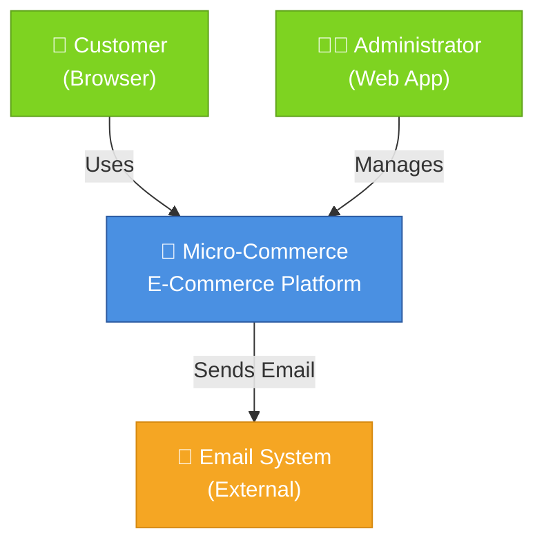
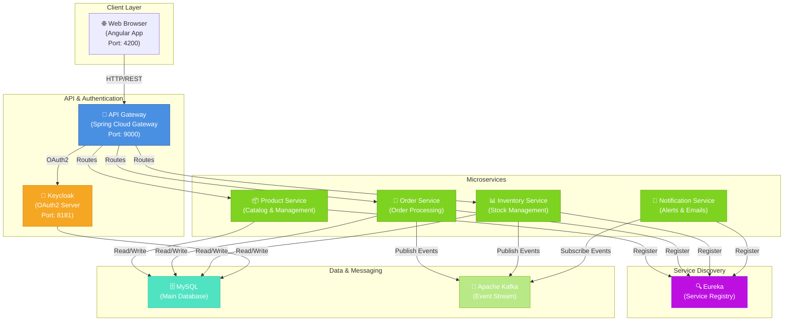
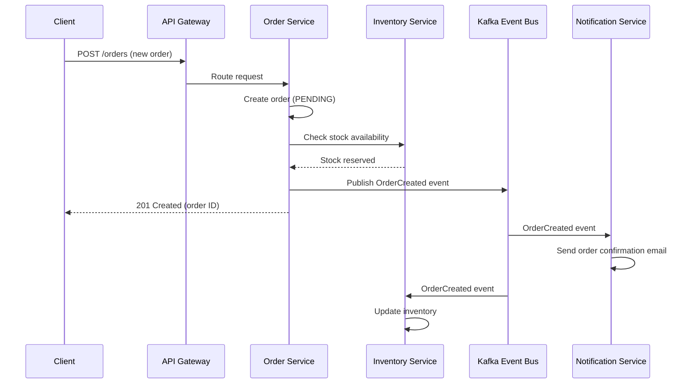

# Architecture

**Document Status:** Draft (Awaiting Wilson Architect Review)  
**Architecture Version:** 1.0  
**Last Updated:** 2026-07-23

---

## 📋 Table of Contents

1. [Architecture Overview](#architecture-overview)
2. [C4 Model Diagrams](#c4-model-diagrams)
3. [Architecture Decision Records (ADRs)](#architecture-decision-records-adrs)
4. [Design Patterns](#design-patterns)
5. [Service Boundaries](#service-boundaries)
6. [Data Flow Diagrams](#data-flow-diagrams)
7. [Technology Decisions](#technology-decisions)
8. [Quality Attributes](#quality-attributes)

---

## Architecture Overview

### Architectural Style

**Microservices Architecture** with the following characteristics:

- **Bounded Contexts** (Domain-Driven Design): Each service owns its domain and data
- **Database per Service**: Polyglot persistence pattern
- **Event-Driven Communication**: Asynchronous messaging via Kafka
- **API-First Design**: RESTful APIs with OpenAPI/Swagger documentation
- **Cloud-Native**: Container-based deployment on Kubernetes

### Architectural Goals

| Goal | Rationale | Metric |
|------|-----------|--------|
| **Scalability** | Independent service scaling based on demand | 10K+ concurrent users |
| **Resilience** | Service failures don't cascade | 99.5% availability |
| **Agility** | Deploy services independently | Multiple deployments/day |
| **Observability** | Understand system behavior across services | Complete distributed tracing |
| **Security** | Secure inter-service communication | Zero-trust model |

---

## C4 Model Diagrams

### Level 1: System Context



**Description**: The Micro-Commerce system serves two primary user groups (customers and administrators) and integrates with external email services for notifications.

### Level 2: Container Architecture



**Description**: Core container architecture showing service separation, communication patterns, and data layer.

### Level 3: Component Architecture (Example: Order Service)

```mermaid
graph TB
    subgraph OrderService["Order Service"]
        subgraph API["API Layer"]
            OrderController["OrderController<br/>(REST Endpoints)"]
        end
        
        subgraph Business["Business Logic"]
            OrderService["OrderService<br/>(Business Rules)"]
            OrderProcessor["OrderProcessor<br/>(Order Workflow)"]
        end
        
        subgraph Data["Data Access"]
            OrderRepository["OrderRepository<br/>(CRUD)"]
            OrderEntity["Order Entity<br/>(Domain Model)"]
        end
        
        subgraph Integration["Integration"]
            EventPublisher["EventPublisher<br/>(Kafka)"]
            ExternalAPIs["External APIs<br/>(Inventory, Payment)"]
        end
    end
    
    OrderController -->|Calls| OrderService
    OrderService -->|Coordinates| OrderProcessor
    OrderProcessor -->|Persists| OrderRepository
    OrderRepository -->|Maps| OrderEntity
    OrderProcessor -->|Publishes| EventPublisher
    OrderProcessor -->|Calls| ExternalAPIs
    
    style OrderController fill:#4a90e2,stroke:#2c5aa0,color:#fff
    style OrderService fill:#7ed321,stroke:#5fa319,color:#fff
    style OrderProcessor fill:#7ed321,stroke:#5fa319,color:#fff
    style OrderRepository fill:#50e3c2,stroke:#2ebd9e,color:#fff
```

---

## Architecture Decision Records (ADRs)

### ADR-001: Microservices over Monolith

**Status**: Accepted  
**Date**: 2026-01-15

**Context**:
The team needed to build a scalable e-commerce platform capable of independent feature deployment and technology flexibility.

**Decision**:
Adopt microservices architecture with bounded contexts per business domain.

**Rationale**:
- Enables independent scaling of services
- Supports rapid feature delivery for different teams
- Allows technology flexibility per service
- Facilitates easier testing and debugging

**Consequences**:
- ✅ Increased scalability and flexibility
- ⚠️ Operational complexity increases
- ⚠️ Distributed system debugging challenges
- ⚠️ Network latency between services

**Alternatives Considered**:
1. Monolithic architecture → Rejected due to scaling limitations
2. SOA (Service-Oriented Architecture) → Too heavyweight for startup phase

---

### ADR-002: Event-Driven Async Communication

**Status**: Accepted  
**Date**: 2026-02-01

**Context**:
Services need to communicate asynchronously without tight coupling, especially for order and inventory operations.

**Decision**:
Use Apache Kafka as the central event bus for inter-service communication.

**Rationale**:
- Decouples services completely
- Provides message durability and replay capability
- Enables event sourcing patterns
- Supports real-time data propagation

**Consequences**:
- ✅ Loose coupling between services
- ✅ Natural audit trail of events
- ⚠️ Eventual consistency model
- ⚠️ Debugging distributed flows is harder

**Alternatives Considered**:
1. RabbitMQ → Chosen Kafka for better scalability
2. REST Synchronous calls → Chosen async for independence

---

### ADR-003: Spring Boot as Primary Framework

**Status**: Accepted  
**Date**: 2026-01-10

**Context**:
Team has strong Java expertise and needs a production-ready framework with excellent ecosystem support.

**Decision**:
Use Spring Boot 3.4.1 with Spring Cloud for all backend services.

**Rationale**:
- Mature ecosystem with extensive libraries
- Strong community support and documentation
- Built-in autoconfiguration reduces boilerplate
- Excellent monitoring and observability tools

**Consequences**:
- ✅ Reduced development time through conventions
- ✅ Rich middleware ecosystem
- ⚠️ Some performance overhead vs lower-level frameworks
- ⚠️ Vendor lock-in to Spring ecosystem

---

### ADR-004: Kubernetes for Orchestration

**Status**: Accepted  
**Date**: 2026-02-15

**Context**:
Team needs to deploy containerized services across multiple environments with automatic scaling and self-healing.

**Decision**:
Use Kubernetes for container orchestration and deployment.

**Rationale**:
- Industry standard for microservices orchestration
- Automatic scaling and load balancing
- Self-healing capabilities
- Rich ecosystem of tools

**Consequences**:
- ✅ Automatic scaling based on metrics
- ✅ Self-healing and resilience
- ⚠️ Increased operational complexity
- ⚠️ Learning curve for new team members

---

### ADR-005: OAuth2 with Keycloak for Authentication

**Status**: Accepted  
**Date**: 2026-01-20

**Context**:
Need centralized authentication and authorization across all microservices with support for multiple identity providers.

**Decision**:
Implement OAuth2 using Keycloak as the identity and access management (IAM) provider.

**Rationale**:
- Centralized authentication and authorization
- Support for multiple identity providers (Google, GitHub, etc.)
- Role-based access control (RBAC)
- Open-source and cost-effective

**Consequences**:
- ✅ Unified authentication across services
- ✅ Support for SSO scenarios
- ⚠️ Additional infrastructure dependency
- ⚠️ Token management complexity

---

## Design Patterns

### Implemented Patterns

#### 1. **API Gateway Pattern**
- **Implementation**: Spring Cloud Gateway
- **Purpose**: Single entry point for all client requests
- **Benefits**: Unified authentication, rate limiting, request routing

#### 2. **Service Discovery Pattern**
- **Implementation**: Spring Cloud Eureka
- **Purpose**: Dynamic service registration and discovery
- **Benefits**: No need for hardcoded service locations

#### 3. **Circuit Breaker Pattern**
- **Implementation**: Resilience4j (planned)
- **Purpose**: Prevent cascading failures
- **Benefits**: Graceful degradation when services fail

#### 4. **Saga Pattern (Choreography)**
- **Implementation**: Kafka event stream
- **Purpose**: Distributed transactions across services
- **Benefits**: Eventual consistency, loose coupling

#### 5. **Event Sourcing Pattern**
- **Implementation**: Kafka event log
- **Purpose**: Maintain audit trail of all business events
- **Benefits**: Complete historical record, replay capability

#### 6. **Database per Service**
- **Implementation**: Separate databases per microservice
- **Purpose**: Data isolation and independence
- **Benefits**: No shared database coupling

---

## Service Boundaries

### Product Service

**Bounded Context**: Product Catalog & Management

```yaml
Responsibilities:
  - Product catalog management
  - Product information (name, description, price)
  - Product categories and classification
  - Search and filtering

Data Ownership:
  - Products table
  - Categories table
  - Product images

Published Events:
  - ProductCreated
  - ProductUpdated
  - ProductDeleted

Consumed Events:
  - InventoryLevelChanged

Dependencies:
  - Eureka (service discovery)
  - Keycloak (authentication)

API Endpoints:
  - GET /api/v1/products
  - GET /api/v1/products/{id}
  - POST /api/v1/products
  - PUT /api/v1/products/{id}
  - DELETE /api/v1/products/{id}
```

### Order Service

**Bounded Context**: Order Processing & Management

```yaml
Responsibilities:
  - Order creation and validation
  - Order state management
  - Order history and tracking
  - Order cancellation and refunds

Data Ownership:
  - Orders table
  - OrderItems table
  - OrderStatus table

Published Events:
  - OrderCreated
  - OrderConfirmed
  - OrderShipped
  - OrderCancelled

Consumed Events:
  - InventoryReserved
  - PaymentProcessed

Dependencies:
  - Inventory Service
  - Notification Service
  - Payment Gateway (external)

API Endpoints:
  - GET /api/v1/orders
  - GET /api/v1/orders/{id}
  - POST /api/v1/orders
  - PUT /api/v1/orders/{id}/cancel
```

### Inventory Service

**Bounded Context**: Stock & Inventory Management

```yaml
Responsibilities:
  - Stock level tracking
  - Inventory reservations
  - Stock adjustments
  - Low-stock alerts

Data Ownership:
  - InventoryItems table
  - InventoryReservations table
  - StockLevels table

Published Events:
  - InventoryReserved
  - InventoryReleased
  - InventoryLevelLow
  - StockOutOfStock

Consumed Events:
  - OrderCreated
  - OrderCancelled

Dependencies:
  - Eureka (service discovery)
  - Notification Service

API Endpoints:
  - GET /api/v1/inventory/{productId}
  - POST /api/v1/inventory/reserve
  - DELETE /api/v1/inventory/reserve/{id}
```

### Notification Service

**Bounded Context**: User Communications & Notifications

```yaml
Responsibilities:
  - Email sending
  - SMS notifications (future)
  - Push notifications (future)
  - Notification templates

Data Ownership:
  - NotificationTemplates table
  - NotificationLog table

Published Events:
  - None

Consumed Events:
  - OrderCreated
  - OrderShipped
  - InventoryLevelLow
  - PaymentProcessed

Dependencies:
  - Email service (external)
  - Kafka

API Endpoints:
  - GET /api/v1/notifications/templates
  - POST /api/v1/notifications/send
```

---

## Data Flow Diagrams

### Order Creation Flow



### Complete Order Processing Flow

```mermaid
graph LR
    Order["📦 Order Created<br/>(PENDING)"]
    CheckStock["✓ Check Stock<br/>(CHECKING)"]
    ReserveInventory["🔒 Reserve Inventory<br/>(RESERVED)"]
    ProcessPayment["💳 Process Payment<br/>(PAYMENT_PENDING)"]
    PaymentConfirmed["✓ Payment Confirmed<br/>(CONFIRMED)"]
    Ship["📤 Ship Order<br/>(SHIPPED)"]
    Deliver["✓ Delivered<br/>(COMPLETED)"]
    
    Order -->|Inventory check| CheckStock
    CheckStock -->|Success| ReserveInventory
    ReserveInventory -->|Notify payment| ProcessPayment
    ProcessPayment -->|Payment success| PaymentConfirmed
    PaymentConfirmed -->|Prepare & ship| Ship
    Ship -->|Customer receives| Deliver
    
    style Order fill:#7ed321
    style Deliver fill:#50e3c2
```



---

## Technology Decisions

### Core Technologies

| Layer | Technology | Version | Rationale |
|-------|-----------|---------|-----------|
| **Language** | Java | 21 | Latest LTS version, strong community |
| **Framework** | Spring Boot | 3.4.1 | Industry standard, great ecosystem |
| **Build Tool** | Maven | Latest | Standardized dependency management |
| **Container** | Docker | Latest | Industry standard containerization |
| **Orchestration** | Kubernetes | Latest | Leading orchestration platform |
| **Service Discovery** | Eureka | Spring Cloud | Integrated with Spring ecosystem |
| **API Gateway** | Spring Cloud Gateway | Latest | Lightweight, Spring-native |
| **Event Bus** | Apache Kafka | 3.x | Scalable, durable event streaming |
| **Primary DB** | MySQL | 8.0 | Reliable, well-understood RDBMS |
| **Analytics DB** | PostgreSQL | Latest | Advanced features, JSONB support |
| **Authentication** | OAuth2/OIDC | - | Industry standard, secure |
| **IAM** | Keycloak | 24.0.1 | Open-source, feature-rich |
| **Frontend** | Angular | Latest | Mature SPA framework |

### Technology Constraints

```yaml
Must-Have:
  - JVM ecosystem for consistency
  - Open-source technologies where possible
  - Cloud-native capabilities
  - Strong community support

Nice-to-Have:
  - Cloud provider agnostic
  - Minimal operational overhead
  - Good observability built-in

Constraints:
  - Java 21+ (to use latest LTS)
  - Spring Boot 3.x (for Spring 6 features)
  - Kubernetes 1.24+ (for recent features)
```

---

## Quality Attributes

### Performance

| Attribute | Target | Approach |
|-----------|--------|----------|
| **Response Time** | p95 < 200ms | Caching, async processing |
| **Throughput** | 1000+ req/s | Load balancing, auto-scaling |
| **Latency** | < 50ms (gateway) | CDN, connection pooling |

### Reliability

| Attribute | Target | Approach |
|-----------|--------|----------|
| **Availability** | 99.5% | Redundancy, health checks |
| **Error Recovery** | Auto-recovery | Circuit breakers, retry logic |
| **Data Integrity** | Zero data loss | Transactions, event sourcing |

### Security

| Attribute | Target | Approach |
|-----------|--------|----------|
| **Authentication** | OAuth2 | Keycloak integration |
| **Authorization** | RBAC | Role-based access control |
| **Data Protection** | Encrypted in transit | HTTPS, TLS 1.2+ |

### Maintainability

| Attribute | Target | Approach |
|-----------|--------|----------|
| **Code Quality** | SonarQube A grade | Regular reviews, static analysis |
| **Test Coverage** | > 80% | Automated testing framework |
| **Documentation** | Complete | Self-documenting code + guides |

---

## Related Documentation

- [Project-Overview.md](./PROJECT-OVERVIEW.md) — Project context and objectives
- [Business-Requirements.md](./BUSINESS-REQUIREMENTS.md) — Functional requirements
- [Implementation-Guide.md](./IMPLEMENTATION-GUIDE.md) — Development guide

---

## Document Metadata

- **Created:** 2026-07-23
- **Status:** Draft (Awaiting Review)
- **Owner:** Wilson Architect (pending)
- **Review Cycle:** Monthly
- **Audience:** Development team, architects

---

## Appendix: Technology References

- [Spring Boot Documentation](https://spring.io/projects/spring-boot)
- [Spring Cloud](https://spring.io/projects/spring-cloud)
- [Kubernetes Official Docs](https://kubernetes.io/docs/)
- [Apache Kafka](https://kafka.apache.org/documentation/)
- [Keycloak](https://www.keycloak.org/documentation.html)

