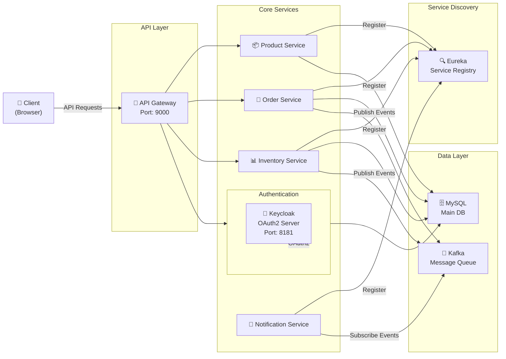

# Micro-Commerce: Project Overview

**Status:** Active Development  
**Version:** 0.0.1-SNAPSHOT  
**Last Updated:** 2026-07-23

---

## 📋 Table of Contents

1. [Executive Summary](#executive-summary)
2. [Project Context](#project-context)
3. [Objectives & Goals](#objectives--goals)
4. [Technical Stack](#technical-stack)
5. [Key Features](#key-features)
6. [Architecture Overview](#architecture-overview)
7. [Stakeholders & Roles](#stakeholders--roles)
8. [Key Metrics & KPIs](#key-metrics--kpis)

---

## Executive Summary

**Micro-Commerce** is a modern e-commerce platform built with **distributed microservices architecture** using **Java Spring Boot** and **Kubernetes**, providing a scalable, resilient foundation for online retail operations.

### Quick Facts

| Aspect | Details |
|--------|---------|
| **Project Type** | E-Commerce Platform (Microservices) |
| **Target Users** | Online shoppers and administrators |
| **Primary Language** | Java 21 |
| **Framework** | Spring Boot 3.4.1 |
| **Container Orchestration** | Docker & Kubernetes |
| **Frontend** | Angular (TypeScript) |
| **Database** | MySQL, PostgreSQL |
| **Message Queue** | Kafka |
| **Authentication** | OAuth2 (Keycloak) |

---

## Project Context

### Business Drivers

- **Scalability**: Handle increasing transaction volumes during peak seasons
- **Reliability**: Ensure 99.5% uptime for business-critical operations
- **Agility**: Enable rapid feature deployment and independent service scaling
- **Maintainability**: Reduce development and operational complexity through service isolation

### Problem Statement

Traditional monolithic e-commerce systems struggle with:

- Tight coupling between business domains
- Difficulty in scaling individual components independently
- Complex deployment cycles affecting the entire application
- Resource utilization inefficiencies
- Extended time-to-market for new features

### Solution Approach

Micro-Commerce addresses these challenges by implementing a **bounded contexts microservices pattern** where each business domain operates as an independent service with:

- Dedicated data stores
- Asynchronous communication via events
- Independent deployment pipelines
- Technology flexibility per service

---

## Objectives & Goals

### Primary Objectives

| Objective | Success Criteria |
|-----------|-----------------|
| **Build scalable architecture** | Handle 10,000+ concurrent users |
| **Implement resilience** | Service degradation instead of system failure |
| **Enable rapid feature delivery** | Sprint-based deployments |
| **Reduce operational overhead** | Automated monitoring and alerting |

### Business Goals

- Increase customer satisfaction through improved performance
- Reduce operational costs via efficient resource utilization
- Enable B2B and B2C expansion through flexible product offerings
- Establish foundation for marketplace features

### Technical Goals

- Implement distributed tracing and observability
- Establish clear API contracts and documentation
- Create comprehensive test automation
- Implement security best practices across services

---

## Technical Stack

### Backend Services

```yaml
Language: Java 21
Framework: Spring Boot 3.4.1
Build Tool: Maven
Cloud Provider: Docker + Kubernetes
```

### Data & Storage

```yaml
Primary DB: MySQL 8.0
Analytics DB: PostgreSQL
Cache: Redis (planned)
Message Queue: Apache Kafka
```

### Infrastructure

```yaml
Container Runtime: Docker
Orchestration: Kubernetes
Service Discovery: Eureka (Spring Cloud)
API Gateway: Spring Cloud Gateway
Load Balancing: Kubernetes Services
```

### Security & Authentication

```yaml
Authentication: OAuth2 / OpenID Connect
Authorization Server: Keycloak 24.0.1
Secrets Management: Environment Variables + Vault (planned)
TLS/SSL: HTTPS enforced
```

### Observability

```yaml
Distributed Tracing: Tempo (planned)
Metrics: Prometheus
Visualization: Grafana
Structured Logging: ELK Stack (planned)
```

### Frontend

```yaml
Framework: Angular
Language: TypeScript
UI Components: TBD
Package Manager: npm/yarn
```

---

## Key Features

### Core Capabilities

#### 1. **Product Management**
- Product catalog with categorization
- Price and inventory management
- Product search and filtering
- Image gallery support

#### 2. **Order Management**
- Shopping cart functionality
- Order creation and tracking
- Order status notifications
- Order history and analytics

#### 3. **Inventory Management**
- Real-time stock tracking
- Inventory reservations
- Stock level alerts
- Low-stock notifications

#### 4. **Authentication & Authorization**
- User registration and login
- Role-based access control (RBAC)
- OAuth2 provider integration
- Session management

#### 5. **Notifications**
- Email notifications
- Order status updates
- Inventory alerts
- User communications

#### 6. **Service Discovery**
- Dynamic service registration
- Health checks
- Load balancing
- Circuit breaking

---

## Architecture Overview

### Microservices Components



### Service Topology

| Service | Port | Purpose | Dependencies |
|---------|------|---------|--------------|
| **API Gateway** | 9000 | Request routing, authentication | Eureka, Keycloak |
| **Product Service** | TBD | Product catalog management | MySQL, Eureka |
| **Order Service** | TBD | Order processing | MySQL, Kafka, Eureka |
| **Inventory Service** | TBD | Stock management | MySQL, Kafka, Eureka |
| **Notification Service** | TBD | User notifications | Kafka, Eureka |
| **Keycloak** | 8181 | OAuth2 authentication | MySQL |
| **Eureka** | TBD | Service discovery | TBD |

---

## Stakeholders & Roles

### Development Team (Avanade Method)

| Role | Responsibility | Key Artifacts |
|------|-----------------|--------------|
| **Wilson Architect** | Technical architecture, ADRs, design patterns | Architecture.md, ADRs |
| **Maria Analyst** | Business requirements, domain analysis | Business-Requirements.md |
| **Tiago Developer** | Implementation, code quality | Implementation-Guide.md |
| **Carla QA** | Testing strategy, quality gates | Testing-Strategy.md |
| **Paige Tech Writer** | Documentation, knowledge consolidation | All documentation |
| **João PM** | Product management, PRD | Project roadmap |
| **Sofia UX** | User experience, accessibility | UI/UX guidelines |

### Project Stakeholders

| Stakeholder | Interest | Engagement |
|------------|----------|-----------|
| **Product Owner** | Feature delivery, ROI | Weekly reviews |
| **DevOps Team** | Deployment, infrastructure | CI/CD configuration |
| **Security Team** | Data protection, compliance | Security reviews |
| **End Users** | Performance, usability | UAT feedback |

---

## Key Metrics & KPIs

### Performance Metrics

```yaml
Response Time:
  Target: p95 < 200ms (business logic)
  Gateway: < 50ms overhead

Throughput:
  Target: 1000+ requests/second
  Peak: Handle 10x load temporarily

Availability:
  Target: 99.5% uptime
  RTO: < 15 minutes
  RPO: < 5 minutes
```

### Quality Metrics

```yaml
Test Coverage:
  Target: > 80% code coverage
  Critical paths: 100%

Defect Density:
  Target: < 5 defects per 1000 LOC
  Critical: 0 defects

Deployment Frequency:
  Target: Daily deployments
  Lead time: < 1 hour
```

### Business Metrics

```yaml
User Satisfaction: > 4.0/5.0 rating
Conversion Rate: > 2.5%
Cart Abandonment: < 70%
Average Order Value: Track trend
Customer Retention: > 60% month-over-month
```

---

## Next Steps

1. **Review & Approval** → Stakeholder sign-off on project scope
2. **Architecture Design** → Wilson completes detailed C4 models and ADRs
3. **Requirements Refinement** → Maria finalizes functional and non-functional requirements
4. **Development Planning** → Sprint planning and task breakdown
5. **Testing Strategy Definition** → Carla defines test automation approach
6. **Environment Setup** → Infrastructure provisioning

---

## Related Documentation

- [Architecture.md](./ARCHITECTURE.md) — Technical architecture and design decisions
- [Business-Requirements.md](./BUSINESS-REQUIREMENTS.md) — Detailed business requirements
- [Implementation-Guide.md](./IMPLEMENTATION-GUIDE.md) — Development setup and building
- [Testing-Strategy.md](./TESTING-STRATEGY.md) — Quality assurance approach
- [Deployment-Guide.md](./DEPLOYMENT-GUIDE.md) — Production deployment process

---

## Document Metadata

- **Created:** 2026-07-23
- **Last Modified:** 2026-07-23
- **Owner:** Paige Tech Writer
- **Review Cycle:** Quarterly
- **Audience:** All stakeholders
- **Confidentiality:** Internal

