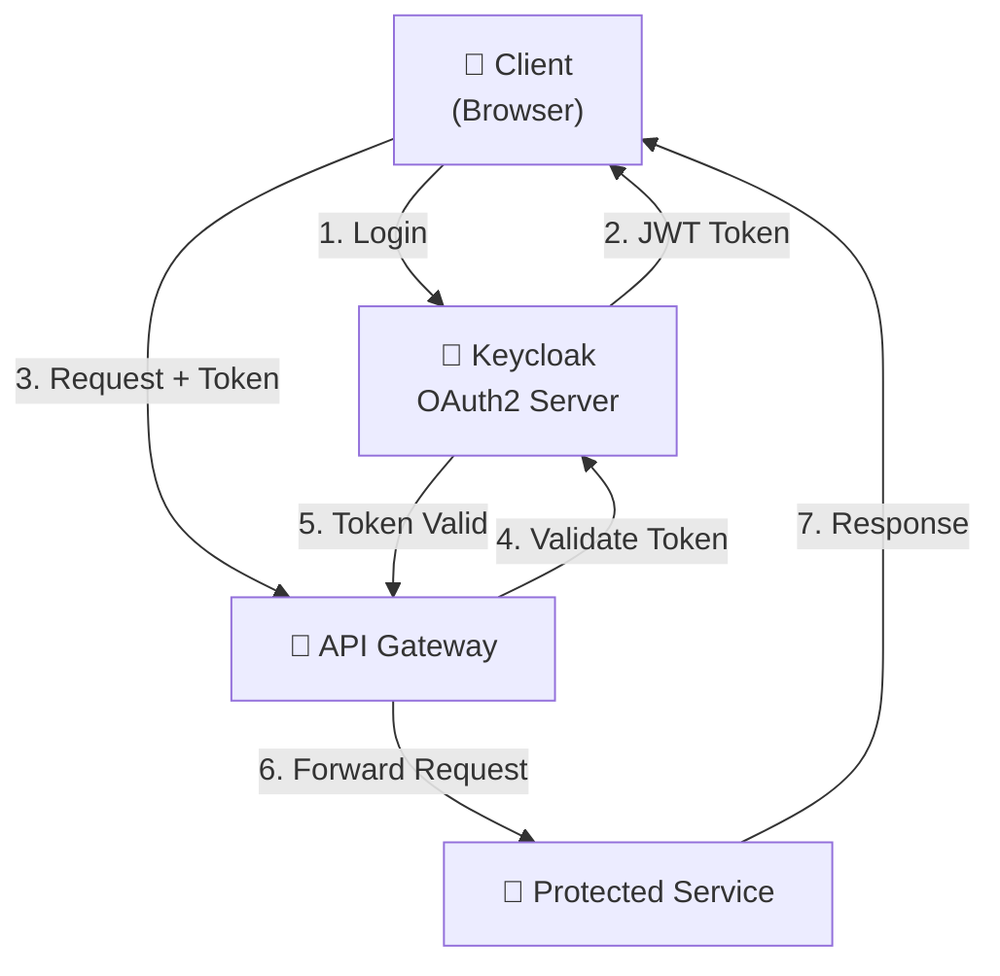

# Security Analysis

**Document Status:** Draft  
**Version:** 1.0  
**Last Updated:** 2026-07-23

---

## 📋 Table of Contents

1. [Security Overview](#security-overview)
2. [Authentication & Authorization](#authentication--authorization)
3. [Data Protection](#data-protection)
4. [API Security](#api-security)
5. [Service-to-Service Security](#service-to-service-security)
6. [Infrastructure Security](#infrastructure-security)
7. [Vulnerability Assessment](#vulnerability-assessment)
8. [Security Checklist](#security-checklist)

---

## Security Overview

### Security Principles

- **Zero Trust Model**: Never trust, always verify
- **Defense in Depth**: Multiple layers of security controls
- **Principle of Least Privilege**: Minimum necessary access
- **Secure by Default**: Security built into architecture
- **Transparency**: Security logs and audit trails

### Security Goals

| Goal | Priority | Status |
|------|----------|--------|
| Prevent unauthorized access | Critical | ✅ In Progress |
| Protect customer data | Critical | ✅ In Progress |
| Prevent data breaches | Critical | ✅ In Progress |
| Ensure service availability | High | ✅ Planned |
| Maintain audit trails | High | ✅ Planned |

---

## Authentication & Authorization

### Authentication Architecture



### OAuth2 Flow

The system uses **OAuth2 Authorization Code Flow** for user authentication:

```sequence
User -> Browser: 1. Click "Login"
Browser -> APIGateway: 2. Redirect to /oauth2/login
APIGateway -> Keycloak: 3. Initiate OAuth2 flow
Keycloak -> Browser: 4. Keycloak login form
Browser -> Keycloak: 5. Enter credentials
Keycloak -> Browser: 6. Authorization code
Browser -> APIGateway: 7. Exchange code for token
APIGateway -> Keycloak: 8. Validate code & issue JWT
Keycloak -> APIGateway: 9. JWT token
APIGateway -> Browser: 10. Set authentication cookie
Browser -> APIGateway: 11. API request with token
APIGateway -> Service: 12. Forward with validated user
```

### JWT Token Structure

```json
{
  "header": {
    "alg": "RS256",
    "typ": "JWT"
  },
  "payload": {
    "iss": "http://keycloak:8080/realms/micro-commerce",
    "sub": "user-id-123",
    "aud": ["api-gateway", "product-service"],
    "exp": 1690000000,
    "iat": 1689913600,
    "email": "user@example.com",
    "roles": ["CUSTOMER", "ADMIN"]
  },
  "signature": "HMAC_SHA256(...)"
}
```

### Authorization Model

**Role-Based Access Control (RBAC)**:

| Role | Permissions | Endpoints |
|------|------------|-----------|
| **CUSTOMER** | Read products, create orders, view own orders | GET /products, POST /orders, GET /orders/{ownerId} |
| **ADMIN** | Full access to all operations | All endpoints |
| **SUPPORT** | View customer orders, update order status | GET /orders, PUT /orders/{id} |

```java
// Authorization annotation
@RestController
@RequestMapping("/api/v1/orders")
public class OrderController {
    
    @GetMapping
    @PreAuthorize("hasRole('CUSTOMER') or hasRole('ADMIN')")
    public ResponseEntity<List<OrderDTO>> getOrders() {
        // Implementation
    }
    
    @PostMapping
    @PreAuthorize("hasRole('CUSTOMER')")
    public ResponseEntity<OrderDTO> createOrder(@RequestBody OrderRequest request) {
        // Implementation
    }
    
    @DeleteMapping("/{id}")
    @PreAuthorize("hasRole('ADMIN')")
    public ResponseEntity<Void> deleteOrder(@PathVariable Long id) {
        // Implementation
    }
}
```

---

## Data Protection

### Data Classification

```yaml
Sensitive Data:
  - Customer names and emails
  - Customer addresses
  - Order history
  - User passwords (hashed)
  
Highly Sensitive:
  - Payment information (NOT stored)
  - Customer authentication tokens
  - API keys and secrets
  
Public Data:
  - Product names and descriptions
  - Product prices
  - Product images
  - Categories
```

### Encryption at Rest

```properties
# Planned encryption implementation
spring.datasource.hikari.data-source-properties.sslMode=REQUIRED

# Application-level encryption for sensitive fields
@Entity
public class User {
    @Id
    private Long id;
    
    @Encrypted  // Custom annotation
    private String email;
    
    @Encrypted
    private String address;
    
    // Standard fields
    private String role;
}
```

### Encryption in Transit

- **HTTPS/TLS 1.2+**: All external communications
- **Service-to-Service**: mTLS with certificates (planned)
- **Database**: SSL connections (configured)

```yaml
# Spring Boot configuration
server:
  ssl:
    enabled: true
    key-store: classpath:keystore.p12
    key-store-password: ${SSL_KEYSTORE_PASSWORD}
    key-store-type: PKCS12
    key-alias: tomcat
```

### Password Management

```java
// Spring Security password encoding
@Configuration
public class SecurityConfig {
    
    @Bean
    public PasswordEncoder passwordEncoder() {
        // BCrypt with strength 12
        return new BCryptPasswordEncoder(12);
    }
}

// Password requirements
@Validated
public class UserDTO {
    @NotBlank
    @Length(min = 8)  // Minimum 8 characters
    @Pattern(regexp = "^(?=.*[a-z])(?=.*[A-Z])(?=.*\\d)(?=.*[@$!%*?&])[A-Za-z\\d@$!%*?&]+$")
    // Must contain: lowercase, uppercase, digit, special char
    private String password;
}
```

### Secrets Management

```properties
# Use environment variables for secrets (NOT hardcoded)
database.password=${DB_PASSWORD}
keycloak.client-secret=${KEYCLOAK_CLIENT_SECRET}
jwt.signing-key=${JWT_SIGNING_KEY}
```

Docker Compose example:

```yaml
environment:
  - MYSQL_ROOT_PASSWORD=${DB_PASSWORD}
  - KEYCLOAK_ADMIN_PASSWORD=${KEYCLOAK_ADMIN_PASSWORD}
  - SPRING_DATASOURCE_PASSWORD=${DB_PASSWORD}
```

---

## API Security

### Input Validation

```java
@RestController
@RequestMapping("/api/v1/products")
public class ProductController {
    
    @PostMapping
    public ResponseEntity<ProductDTO> createProduct(
        @Valid @RequestBody ProductRequest request) {
        // Input automatically validated before method execution
    }
}

// Validation annotation
public class ProductRequest {
    @NotBlank(message = "Product name is required")
    @Length(min = 3, max = 255)
    private String name;
    
    @NotBlank
    @Length(min = 10, max = 2000)
    private String description;
    
    @NotNull
    @Positive(message = "Price must be positive")
    private BigDecimal price;
    
    @NotNull
    @Min(0)
    @Max(1000000)
    private Integer stock;
}
```

### SQL Injection Prevention

```java
// Safe: Using Spring Data JPA (parameterized queries)
@Repository
public interface ProductRepository extends JpaRepository<Product, Long> {
    
    // Named parameters
    @Query("SELECT p FROM Product p WHERE p.name = :name")
    Optional<Product> findByName(@Param("name") String name);
    
    // Query methods (auto-translated to parameterized queries)
    Optional<Product> findBySku(String sku);
}

// Unsafe: AVOID
String query = "SELECT * FROM products WHERE name = '" + name + "'";  // ❌ SQL Injection!
```

### CSRF Protection

```java
@Configuration
@EnableWebSecurity
public class SecurityConfig {
    
    @Bean
    public SecurityFilterChain filterChain(HttpSecurity http) throws Exception {
        http
            .csrf()
                .csrfTokenRepository(CookieCsrfTokenRepository.withHttpOnlyFalse())
            .and()
            .authorizeRequests()
                .antMatchers("/api/public/**").permitAll()
                .anyRequest().authenticated();
        
        return http.build();
    }
}
```

### Rate Limiting

```java
// Implement rate limiting at API Gateway
@Component
public class RateLimitFilter implements Filter {
    
    @Override
    public void doFilter(ServletRequest request, ServletResponse response, 
                        FilterChain chain) throws IOException, ServletException {
        // Rate limit: 100 requests per minute per IP
        HttpServletRequest httpRequest = (HttpServletRequest) request;
        String clientIp = httpRequest.getRemoteAddr();
        
        if (!isWithinRateLimit(clientIp)) {
            ((HttpServletResponse) response).sendError(HttpStatus.TOO_MANY_REQUESTS.value());
            return;
        }
        
        chain.doFilter(request, response);
    }
    
    private boolean isWithinRateLimit(String clientIp) {
        // Implementation using Redis or local cache
        return true;
    }
}
```

### CORS Configuration

```java
@Configuration
public class CorsConfig {
    
    @Bean
    public WebMvcConfigurer corsConfigurer() {
        return new WebMvcConfigurer() {
            @Override
            public void addCorsMappings(CorsRegistry registry) {
                registry.addMapping("/api/**")
                    .allowedOrigins("https://shop.example.com")
                    .allowedMethods("GET", "POST", "PUT", "DELETE")
                    .allowedHeaders("*")
                    .maxAge(3600)
                    .allowCredentials(true);
            }
        };
    }
}
```

---

## Service-to-Service Security

### Current Implementation: Eureka Service Discovery

```java
// Services register with Eureka and discover each other
@Configuration
public class EurekaClientConfig {
    
    @Bean
    public RestTemplate restTemplate() {
        return new RestTemplate();
    }
}

// Service-to-service call (unencrypted - to be secured)
@Service
public class OrderService {
    
    @Autowired
    private RestTemplate restTemplate;
    
    public InventoryDTO checkInventory(Long productId) {
        // Current: Plain HTTP (needs securing)
        return restTemplate.getForObject(
            "http://inventory-service/api/v1/inventory/" + productId,
            InventoryDTO.class
        );
    }
}
```

### Planned: mTLS (Mutual TLS)

```yaml
# Istio service mesh configuration (planned)
apiVersion: security.istio.io/v1beta1
kind: PeerAuthentication
metadata:
  name: default
spec:
  mtls:
    mode: STRICT  # Enforce mTLS for all services
---
apiVersion: security.istio.io/v1beta1
kind: AuthorizationPolicy
metadata:
  name: allow-product-to-order
spec:
  rules:
    - from:
        - source:
            principals: ["cluster.local/ns/default/sa/order-service"]
      to:
        - operation:
            methods: ["GET", "POST"]
            paths: ["/api/v1/products*"]
```

---

## Infrastructure Security

### Container Security

```dockerfile
# Dockerfile best practices
FROM openjdk:21-slim

# Run as non-root user
RUN useradd -m -u 1000 appuser
USER appuser

# Copy application
COPY target/*.jar app.jar

# Read-only filesystem
RUN chmod 444 app.jar

# Health check
HEALTHCHECK --interval=30s --timeout=5s --start-period=10s --retries=3 \
    CMD curl -f http://localhost:8080/actuator/health || exit 1

ENTRYPOINT ["java", "-jar", "app.jar"]
```

### Kubernetes Network Policies

```yaml
# Restrict traffic between pods
apiVersion: networking.k8s.io/v1
kind: NetworkPolicy
metadata:
  name: allow-product-service
spec:
  podSelector:
    matchLabels:
      app: product-service
  policyTypes:
    - Ingress
    - Egress
  ingress:
    - from:
        - podSelector:
            matchLabels:
              app: api-gateway
  egress:
    - to:
        - podSelector:
            matchLabels:
              app: mysql
      ports:
        - protocol: TCP
          port: 3306
    - to:
        - namespaceSelector: {}
      ports:
        - protocol: TCP
          port: 53  # DNS
```

---

## Vulnerability Assessment

### OWASP Top 10

| # | Vulnerability | Mitigation | Status |
|---|----------------|-----------|--------|
| 1 | Broken Access Control | RBAC, authorization checks | ✅ Implemented |
| 2 | Cryptographic Failures | TLS in transit, encrypted at rest | ⚠️ Partial |
| 3 | Injection | Parameterized queries, input validation | ✅ Implemented |
| 4 | Insecure Design | Security-first design, threat modeling | ⚠️ In Progress |
| 5 | Security Misconfiguration | Security headers, default deny | ✅ Implemented |
| 6 | Vulnerable Components | Dependency scanning, updates | ⚠️ Weekly scans |
| 7 | Authentication Failures | OAuth2, JWT, rate limiting | ✅ Implemented |
| 8 | Data Integrity Failures | Audit logs, request signing | ⚠️ Planned |
| 9 | Logging & Monitoring | Structured logging, monitoring | ⚠️ In Progress |
| 10 | SSRF | URL validation, network policies | ⚠️ Planned |

### Dependency Scanning

```bash
# Check for vulnerable dependencies
mvn dependency-check:check

# Generate SBOM (Software Bill of Materials)
mvn cyclonedx:makeAggregate

# Check specific service
cd product-service
mvn org.owasp:dependency-check-maven:check
```

---

## Security Checklist

### Development Time

- [ ] Input validation on all endpoints
- [ ] SQL injection protection via parameterized queries
- [ ] CSRF protection enabled
- [ ] CORS properly configured
- [ ] Secrets not hardcoded
- [ ] Authentication/authorization enforced
- [ ] Logs don't contain sensitive data
- [ ] Error messages generic (no stack traces)
- [ ] Dependencies scanned for vulnerabilities
- [ ] Security tests written and passing

### Deployment Time

- [ ] HTTPS/TLS enabled
- [ ] API Gateway requires authentication
- [ ] Database connections use encrypted channels
- [ ] Secrets stored in secure vault
- [ ] Firewall rules enforced
- [ ] Network policies applied
- [ ] Rate limiting configured
- [ ] Security headers set (CSP, HSTS, etc.)
- [ ] Monitoring and alerting active
- [ ] Audit logging configured

---

## Related Documentation

- [Architecture.md](./ARCHITECTURE.md) — Technical design
- [Implementation-Guide.md](./IMPLEMENTATION-GUIDE.md) — Configuration details

---

## Document Metadata

- **Created:** 2026-07-23
- **Status:** Draft
- **Owner:** Security Team (pending)
- **Audience:** Development and DevOps teams

