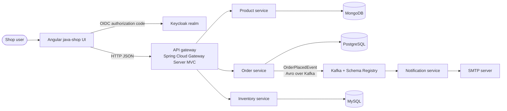
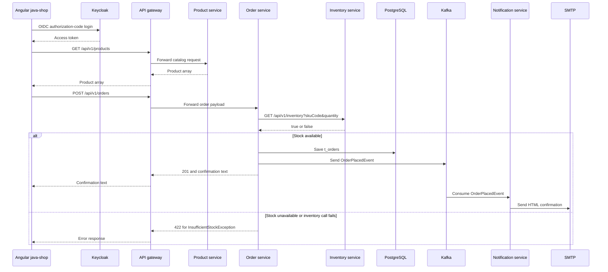

# Architecture

[Back to the documentation hub](index.md) · [Back to the README](../README.md)

**Source baseline:** branch `feature/kubernetes`, HEAD `b3dafa4416ca12a90ae7cfd5249b166c42321799` (`b3dafa4`), dated 2025-01-17.  
**Documentation state:** `README.md` and `docs/**` are current uncommitted working-tree changes from this pass.  
**Analysis date:** 2026-09-01.  
**Evidence mode:** static source/configuration inspection; runtime behavior was not verified. No pre-existing project-local docs directory was found before this pass.

## Scope and confidence

This is a brownfield description of the repository, not a target-state design. Component names, ports, routes, and dependencies below come from the inspected source and configuration. The business interpretation of “customer”, “catalog”, and “shop” is **[Inferred]** from the UI labels, package names, and request flow.

## System context

The intended slice is a web shop in which a user authenticates, views products, submits a single-SKU order, and receives an asynchronous order email. Keycloak is the identity provider. The gateway is the public application entry point in the intended path. The backend has four domain services—product, order, inventory, and notification—plus the gateway application.

**Text equivalent:** the primary Angular application is configured to obtain identity from Keycloak and send catalog/order requests to the gateway. The gateway forwards them to the three HTTP domain services: product, order, and inventory. Each data-owning service uses its declared database. The order service checks inventory synchronously, saves an order, and sends an Avro event to Kafka. The fourth domain service, notification, consumes that event and sends an HTML email through SMTP.

**Evidence boundary:** this diagram describes source-level intent and declared topology. It does not prove that a request, event, email, dependency, or deployment succeeds.

**Source anchors:** `frontend/java-shop/src/app/app.config.ts`, `api-gateway/src/main/java/com/js/gateway/infra/Router.java`, the three HTTP service controllers, `order-service/src/main/java/com/js/microservices/order_service/application/service/OrderServiceImpl.java`, and `notification-service/src/main/java/com/js/microservices/notification/application/consumer/kafka/KafkaOrderConsumer.java`.

## Container view

| Container | Role | Declared technology | Primary evidence |
|---|---|---|---|
| `frontend/java-shop` | Primary browser UI source for catalog, product creation, login, and order submission | Angular 17.3 declarations, TypeScript, OIDC client | `frontend/java-shop/package.json`, `src/app/` |
| `frontend/java-shop-website` | Separate SSR scaffold/placeholder | Angular 17.3 declarations, Angular SSR, Express | `frontend/java-shop-website/package.json`, `frontend/java-shop-website/src/app/app.component.html` |
| `api-gateway` | HTTP entry point, routing, JWT resource-server configuration, CORS, circuit-breaker filters | Spring Boot 3.4.1, Spring Cloud Gateway Server MVC | `api-gateway/pom.xml`, `Router.java`, `SecurityConfig.java` |
| `product-service` | Create and list products | Spring MVC, Spring Data MongoDB, Kotlin DTO/entity types | `product-service/product-service/pom.xml`, `ProductController.java` |
| `order-service` | Check inventory, persist one order, publish order event | Spring MVC, JPA/PostgreSQL, RestClient HTTP interface, Kafka/Avro | `order-service/pom.xml`, `OrderServiceImpl.java` |
| `inventory-service` | Read-only stock availability check | Spring MVC, JPA/MySQL, Flyway | `inventory-service/inventory-service/pom.xml`, `InventoryController.java` |
| `notification-service` | Consume order event and send confirmation mail | Spring MVC, Spring Kafka, Spring Mail | `notification-service/pom.xml`, `KafkaOrderConsumer.java` |
| Infrastructure | Identity, databases, messaging, and telemetry | Keycloak, MySQL, PostgreSQL, MongoDB, Kafka, Schema Registry, Prometheus, Loki, Tempo, Grafana | `docker-compose.yaml`, `k8s/manifest/` |

## Request flow: catalog and order

### Numbered flow equivalent

| # | Actor | Success branch | Failure branch or limit |
|---:|---|---|---|
| 1 | Browser → Keycloak | Browser starts the OIDC authorization-code flow and receives token state. | Identity-provider reachability and token exchange are not runtime-verified. |
| 2 | Browser → Gateway | Browser requests `GET /api/v1/products`; gateway forwards it to product and returns the product response. | Gateway authentication, forwarding, and response behavior are not runtime-verified. |
| 3 | Browser → Gateway → Order | Browser posts `POST /api/v1/orders`; gateway forwards the payload to order. | Invalid, unauthenticated, or dependency-failed requests may be rejected; exact runtime responses are not established here. |
| 4 | Order → Inventory | Order calls inventory with `skuCode` and `quantity`. | A `false` result or the order client's fallback leads to `InsufficientStockException` and the source-declared `422` path. |
| 5 | Order → PostgreSQL | If inventory is available, the order is calculated and saved to `t_orders`. | Database failure handling and rollback behavior are not established by this static description. |
| 6 | Order → Kafka | Order builds and sends `OrderPlacedEvent`. | The producer send result is not handled; no outbox or compensating action was found. |
| 7 | Kafka → Notification → SMTP | Notification consumes the event and requests an HTML confirmation email through SMTP. | Kafka delivery, duplicate handling, consumer recovery, SMTP reachability, and mail delivery are not runtime-verified. |

**Important transaction boundary:** `OrderServiceImpl.placeOrder` calls inventory, saves the order, and then calls the producer. `KafkaOrderProducer` invokes `kafka.send(...)` without handling the returned future. There is no inspected outbox, idempotency key, or compensating action. This is a **[Verified] static gap**, not a claim that a failure has occurred in production.

## Component view by boundary

### Gateway

`api-gateway/src/main/java/com/js/gateway/infra/Router.java` declares six forwarding route functions and a local fallback route:

- Product requests at `/api/v1/products`.
- Order requests at `/api/v1/orders`.
- Inventory requests at `/api/v1/inventory`.
- Aggregated OpenAPI paths under `/aggregate/{service}/v3/api-docs` for the product, order, and inventory applications, where the inspected dependencies, controllers, and configuration support those paths.
- A source-declared `GET /fallback` response with HTTP 503 and a plain-text message.

Each gateway application route and API-doc route has a Resilience4j circuit-breaker filter in `Router.java`, with a fallback URI of `forward:/fallback`. The local fallback route is declared only for `GET /fallback`, so no handling for every original request method is inferred. Fallback invocation and response behavior are runtime-unverified. No gateway retry filter is evidenced; the retry configuration in the gateway YAML is not treated as proof that routes retry. The target URLs come from `services.url.*`, not from service discovery.

`SecurityConfig` permits documentation, Prometheus, and aggregate paths, then declares authentication for other requests. It configures JWT resource-server support using `spring.security.oauth2.resourceserver.jwt.issuer-uri`. Notification has no inspected REST controller or Springdoc dependency/configuration, so it is not included in the API-doc aggregation.

### Product service

`ProductController` exposes `POST` and `GET` at `/api/v1/products`. `CreateProductUseCaseImpl` maps the DTO into a MongoDB document named `products`; `GetAllProductsUseCaseImpl` reads all documents. No update or delete controller was found in the inspected source.

### Order service

`OrderController` exposes `POST /api/v1/orders`. `OrderServiceImpl` checks inventory, creates a generated UUID/order number, calculates `price × quantity`, persists `t_orders`, and publishes `OrderPlacedEvent`. Separately, `InventoryGateway` uses a Spring HTTP service proxy with a three-second timeout declaration, a circuit breaker, a `@Retry` annotation, and a fallback that returns `false`. This order-service inventory-client retry is distinct from the gateway circuit-breaker filters; gateway retry behavior is not inferred from configuration alone.

### Inventory service

`InventoryController` exposes `GET /api/v1/inventory` with `skuCode` and `quantity` query parameters. The repository method checks whether a row exists with matching SKU and quantity greater than or equal to the requested quantity. The code does not decrement or reserve stock.

### Notification service

`KafkaOrderConsumer` listens to the configured order-placed topic, maps the event into a mail DTO, formats an HTML body, and delegates to `JavaMailSender`. No persistence, deduplication store, explicit dead-letter topic, or retry policy was found in the inspected notification source.

## Data ownership

- **Product data:** MongoDB collection `products`, mapped by `ProductModel`.
- **Order data:** PostgreSQL table `t_orders`, created by `order-service/src/main/resources/db/migration/V1__init.sql`.
- **Inventory data:** MySQL table `t_inventory`, created and seeded by Flyway migrations under `inventory-service/inventory-service/src/main/resources/db/migration/`.
- **Identity data:** Keycloak is configured with a MySQL dependency and an imported realm artifact. The realm export is configuration data and may contain sensitive operational material; do not copy it into documentation.
- **Telemetry data:** Prometheus scrapes actuator metrics; Loki receives logs; Tempo receives Zipkin traces; Grafana provisions datasource definitions.

## Security boundary

The browser configuration declares `angular-auth-oidc-client` authorization-code flow, silent renew, and refresh-token usage in `frontend/java-shop/src/app/auth/auth.config.ts`. This is configuration evidence, not proof that a token is attached to requests. Static inspection of `frontend/java-shop/src/app/interceptor/auth.interceptor.ts` shows that it subscribes asynchronously to `getAccessToken()`, calls `next(req)` immediately outside the subscription, and calls `next(...)` again inside the subscription. It does not return the token-bearing request from the subscription, so duplicate requests are possible and effective bearer forwarding is unverified. The gateway is configured for bearer JWT validation, but runtime validation and downstream authorization are not evidenced. The inspected product, order, inventory, and notification applications do not contain their own `SecurityFilterChain` declarations. Local Compose publishes backend ports directly, so the gateway is not necessarily the only reachable path.

## Discovery drift

The pre-pass/baseline README claimed Eureka as a service-discovery component. No Eureka application, Eureka client dependency, `lb://` route, or Eureka registry manifest was found in the inspected snapshot. Routes use fixed service URLs in Compose and Kubernetes DNS names in manifests. Eureka implementation is therefore not evidenced; the difference is documented as baseline documentation/implementation drift.

## Observability boundary

The services declare Actuator, Prometheus registry, Micrometer tracing, Brave, Zipkin reporting, and Loki appenders in their POMs. The resource files expose health/metrics endpoints and set trace sampling to `1.0`. Prometheus configurations use static targets. The repository contains configuration for telemetry, but no runtime proof demonstrates that all endpoints, scrape targets, log pushes, traces, dashboards, or alerts work.

## Evidence limits

- No runtime topology or network call was used to validate reachability.
- Dockerfiles build with tests skipped; this documents image instructions, not a successful image build.
- Kubernetes manifests are present but contain configuration and schema inconsistencies documented in [Operations](operations.md) and [Configuration](configuration.md).
- The diagrams intentionally omit unverified infrastructure behavior and do not represent a production deployment recommendation.
