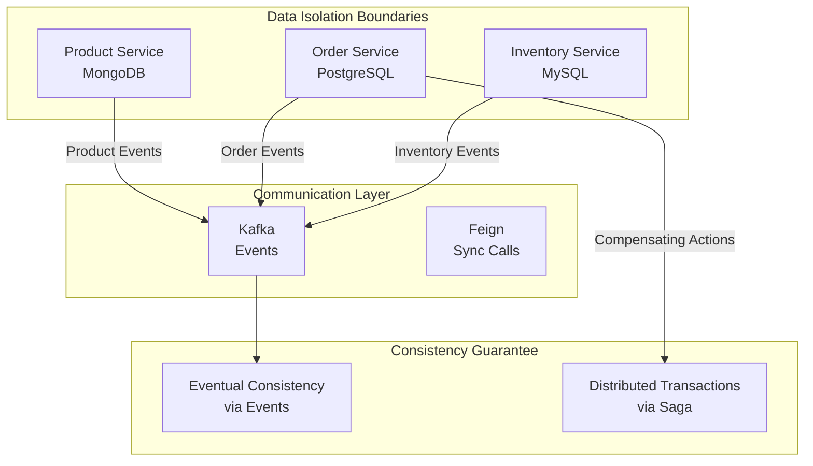

# ADR-002: Database-per-Service Pattern

**Status:** ✅ Implementado  
**Data:** 2026-07-23  
**Decisores:** Architecture Team  
**Tech Stack:** MongoDB, PostgreSQL, MySQL, Flyway

---

## 📋 Contexto

Na arquitetura monolítica, todos os serviços compartilham um único banco de dados centralizado. Isso cria:

- 🔴 Acoplamento de dados entre domínios
- 🔴 Dificuldade de escalar independentemente
- 🔴 Schema migrations bloqueiam múltiplos serviços
- 🔴 Impossibilidade de otimizar BD por caso de uso

## 🎯 Decisão

**Cada microserviço possui seu próprio banco de dados otimizado para seu caso de uso:**

```
┌──────────────────┐
│ Product Service  │──→ MongoDB (NoSQL)
│                  │    Schema-less
│ Read-heavy       │    Denormalization OK
└──────────────────┘

┌──────────────────┐
│ Order Service    │──→ PostgreSQL (Relational)
│                  │    Strong consistency
│ Transactional    │    ACID guarantees
└──────────────────┘

┌──────────────────┐
│ Inventory Serv.  │──→ MySQL + Flyway
│                  │    High availability
│ Consistency-hot  │    Version control
└──────────────────┘
```

## 🗄️ Justificativa da Escolha por Serviço

### 1️⃣ **Product Service → MongoDB**

**Por que NoSQL?**

- ✅ Catálogo de produtos é read-heavy (80/20 rule)
- ✅ Schema evolui constantemente (atributos dinâmicos por categoria)
- ✅ Desnormalização melhora performance de leitura
- ✅ Escalabilidade horizontal com sharding

**Implementação:**

```java
@Document(collection = "products")
public class Product {
    @Id
    private String id;
    private String name;
    private BigDecimal price;
    private Map<String, Object> attributes; // Flexibilidade
    private List<String> categories;
}

@Repository
public interface ProductRepository extends MongoRepository<Product, String> {
    List<Product> findByCategoriesContaining(String category);
}
```

**Dados de Teste:**

```json
{
  "_id": "prod-123",
  "name": "Laptop Dell XPS",
  "price": 2999.99,
  "categories": ["electronics", "computers"],
  "attributes": {
    "cpu": "Intel i7",
    "ram": "16GB",
    "screen": "13.4 FHD"
  }
}
```

### 2️⃣ **Order Service → PostgreSQL**

**Por que RDBMS?**

- ✅ Pedidos requerem ACID (atomicidade crítica)
- ✅ Múltiplas relacionamentos: Order → Items → Products
- ✅ Queries complexas com JOINs
- ✅ Suporta distributed transactions (preparação para 2PC)

**Implementação com JPA:**

```java
@Entity
@Table(name = "orders")
public class Order {
    @Id
    @GeneratedValue(strategy = GenerationType.IDENTITY)
    private Long id;

    @OneToMany(cascade = CascadeType.ALL)
    @JoinColumn(name = "order_id")
    private List<OrderItem> items;

    @Enumerated(EnumType.STRING)
    private OrderStatus status;

    private LocalDateTime createdAt;
}

@Entity
@Table(name = "order_items")
public class OrderItem {
    @Id
    @GeneratedValue(strategy = GenerationType.IDENTITY)
    private Long id;

    private String productId;
    private Integer quantity;
    private BigDecimal unitPrice;
}
```

**Versionamento com Flyway:**

```sql
-- db/migration/V1__init_order_schema.sql
CREATE TABLE orders (
    id BIGSERIAL PRIMARY KEY,
    status VARCHAR(50) NOT NULL,
    created_at TIMESTAMP NOT NULL DEFAULT NOW(),
    total_amount DECIMAL(10, 2)
);

CREATE TABLE order_items (
    id BIGSERIAL PRIMARY KEY,
    order_id BIGINT NOT NULL REFERENCES orders(id),
    product_id VARCHAR(100),
    quantity INT,
    unit_price DECIMAL(10, 2)
);

CREATE INDEX idx_orders_status ON orders(status);
```

### 3️⃣ **Inventory Service → MySQL**

**Por que MySQL aqui?**

- ✅ Operações CRUD simples mas críticas
- ✅ Consistency é mandatória (stock real-time)
- ✅ Replicação master-slave disponível
- ✅ Performance de índices B+ tree para lookups rápidos

**Schema:**

```java
@Entity
@Table(name = "inventory")
public class Inventory {
    @Id
    @GeneratedValue(strategy = GenerationType.IDENTITY)
    private Long id;

    @Column(unique = true)
    private String productId;

    private Integer quantityOnHand;
    private Integer quantityReserved;

    @Version
    private Long version; // Otimistic locking
}
```

## ⚠️ Desafios Resultantes

| Desafio                     | Solução                                    |
| --------------------------- | ------------------------------------------ |
| **Queries cross-service**   | Event Sourcing + CQRS para read replicas   |
| **Transações distribuídas** | Saga Pattern com compensating transactions |
| **Sincronização de dados**  | Kafka eventos de domínio                   |
| **Data consistency**        | Eventual consistency model + retry logic   |

## 🔄 Exemplo: Saga Pattern para Order Creation

```java
@Saga
public class OrderSaga {

    @SagaEventHandler(associationProperty = "orderId")
    public void handle(OrderCreatedEvent event) {
        // Step 1: Reservar inventory
        send(new ReserveInventoryCommand(event.getOrderId(),
                                         event.getItems()));
    }

    @SagaEventHandler(associationProperty = "orderId")
    public void handle(InventoryReservedEvent event) {
        // Step 2: Processar pagamento
        send(new ProcessPaymentCommand(event.getOrderId(),
                                       event.getAmount()));
    }

    @SagaEventHandler(associationProperty = "orderId")
    public void handle(PaymentProcessedEvent event) {
        // Step 3: Confirmar pedido
        send(new ConfirmOrderCommand(event.getOrderId()));
    }

    @SagaEventHandler(associationProperty = "orderId")
    public void handle(PaymentFailedEvent event) {
        // COMPENSATE: Liberar inventory
        send(new ReleaseInventoryCommand(event.getOrderId()));
    }
}
```

## 📊 Matriz Comparativa: Escolha de BD

| Critério                           | MongoDB    | PostgreSQL      | MySQL         |
| ---------------------------------- | ---------- | --------------- | ------------- |
| **Consistency**                    | Eventual   | ACID ⭐⭐⭐⭐⭐ | ACID ⭐⭐⭐⭐ |
| **Escalabilidade Horizontal**      | ⭐⭐⭐⭐⭐ | ⭐⭐⭐          | ⭐⭐⭐        |
| **Flexibilidade Schema**           | ⭐⭐⭐⭐⭐ | ⭐⭐⭐          | ⭐⭐⭐        |
| **Transações Complexas**           | ⭐⭐⭐     | ⭐⭐⭐⭐⭐      | ⭐⭐⭐⭐      |
| **Query Performance (read-heavy)** | ⭐⭐⭐⭐⭐ | ⭐⭐⭐⭐        | ⭐⭐⭐⭐      |
| **Operações (write-heavy)**        | ⭐⭐⭐⭐⭐ | ⭐⭐⭐⭐⭐      | ⭐⭐⭐⭐⭐    |

## 🎯 Impacto na Arquitetura



## 🚀 Melhoria Recomendada

**Implementar CQRS (Command Query Responsibility Segregation)** para leitura cross-service:

```java
// Command Side (atualiza banco)
@Service
public class OrderCommandService {
    public void createOrder(CreateOrderCommand cmd) {
        Order order = new Order(cmd);
        orderRepository.save(order);
        eventBus.publish(new OrderCreatedEvent(order));
    }
}

// Query Side (read replicas em Elasticsearch/MongoDB)
@Service
public class OrderQueryService {
    @Autowired
    private MongoTemplate queryDb;

    public OrderDTO getOrderWithDetails(Long orderId) {
        return queryDb.findById(orderId, OrderDTO.class);
    }
}
```

---

**Relacionado:** ADR-001, ADR-006, ADR-007  
**Referências:**

- [Database per Service - Chris Richardson](https://microservices.io/patterns/data/database-per-service.html)
- [Saga Pattern - AWS Microservices Guide](https://aws.amazon.com/pt/blogs/architecture/saga-pattern-implementation-in-spring-boot-microservices/)
