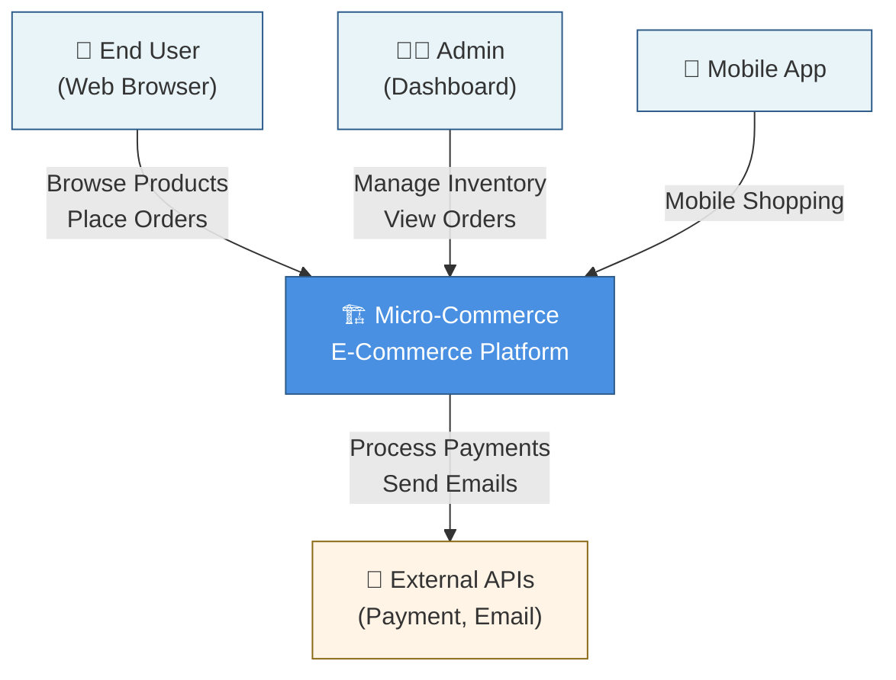
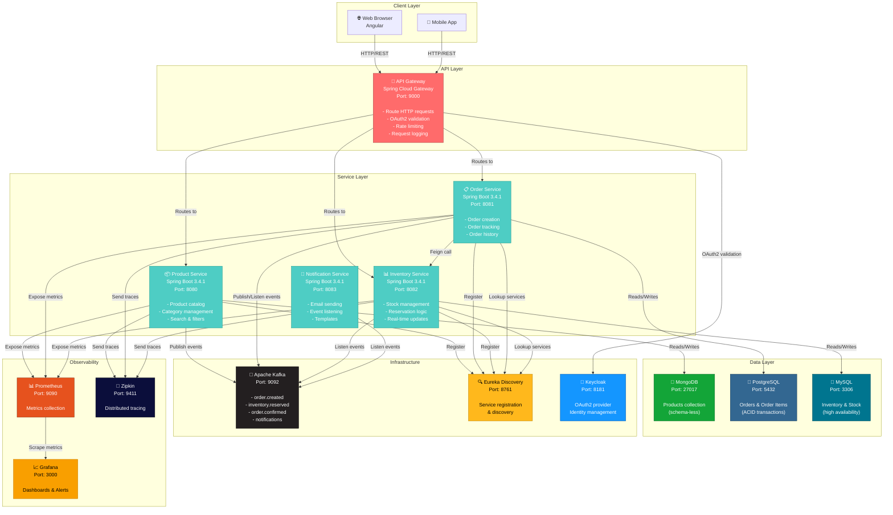
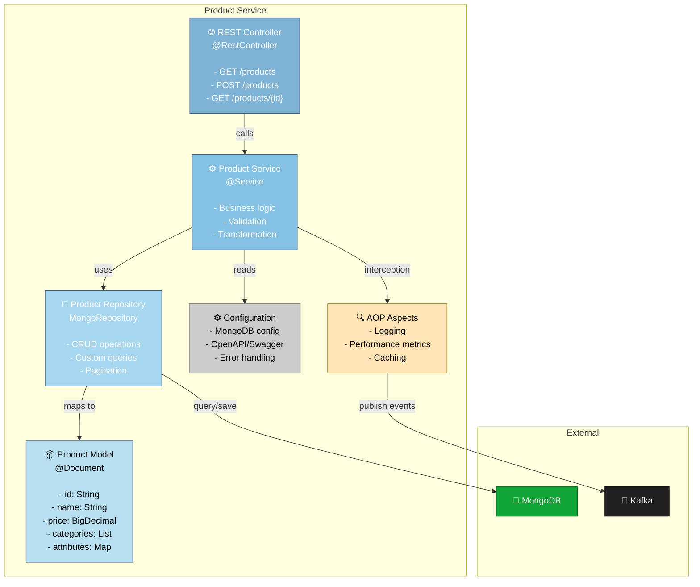
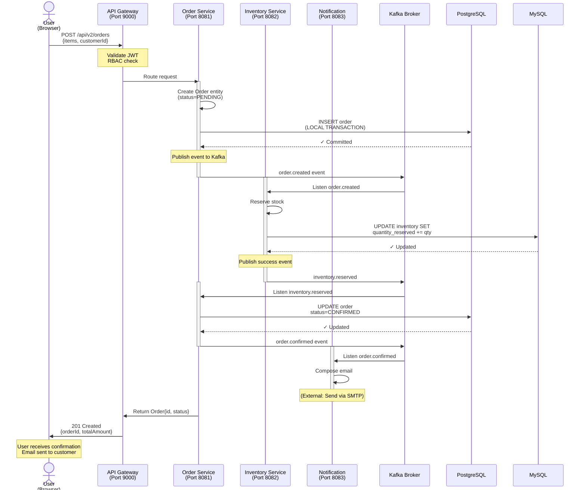
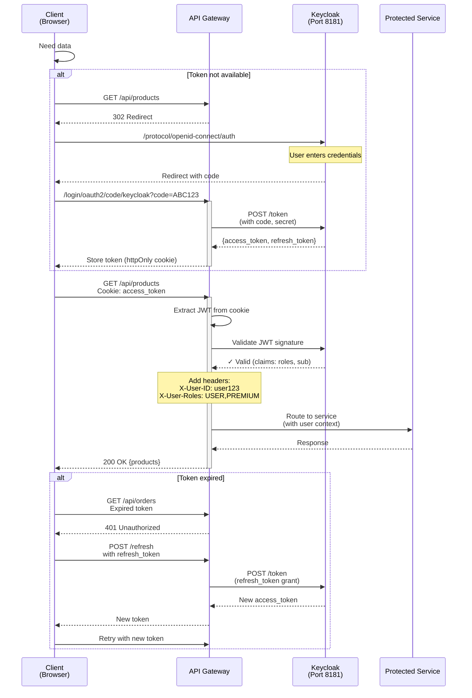
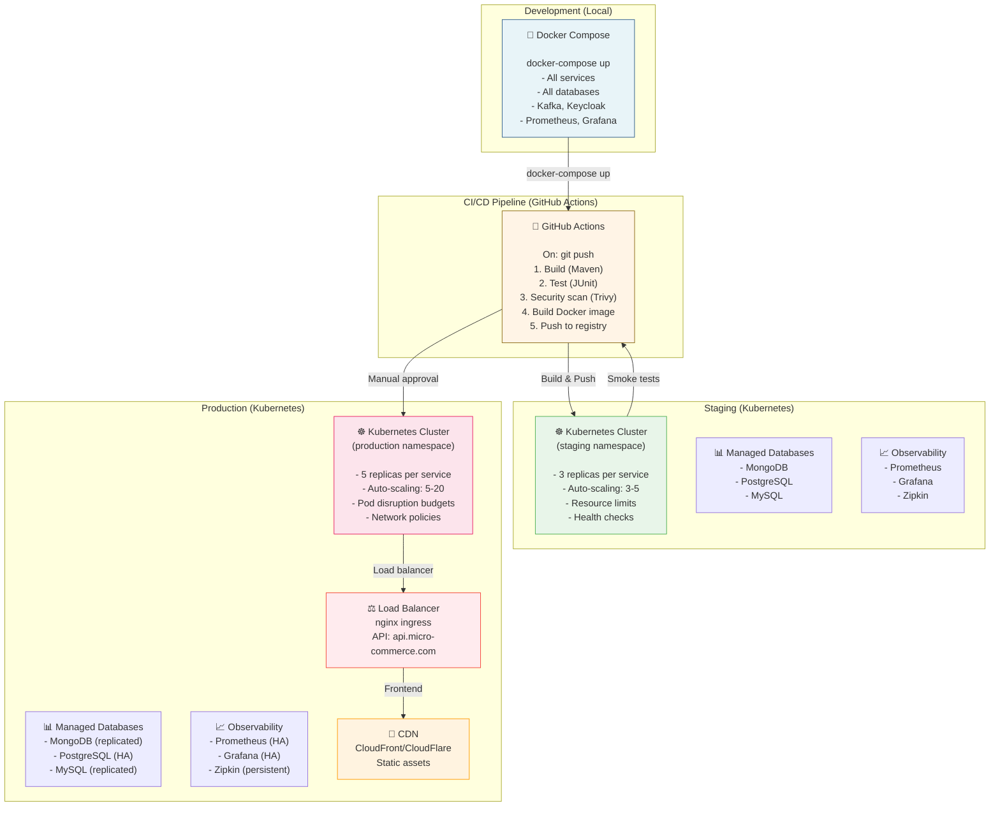

# C4 Model - Micro-Commerce Architecture

## 🎯 System Context Diagram

## 🏢 Container Diagram

## 🔧 Component Diagram (Product Service - Example)

## 🔄 Data Flow: Order Creation Saga

## 🔒 Security Flow: OAuth2 Authentication

## 🎯 Deployment Architecture

---

**Próximas seções:**
- [Matriz de Decisões Tecnológicas](./TECHNOLOGY-MATRIX.md)
- [Análise de Padrões](./PATTERNS-ANALYSIS.md)
- [Recomendações de Melhorias](./RECOMMENDATIONS.md)
