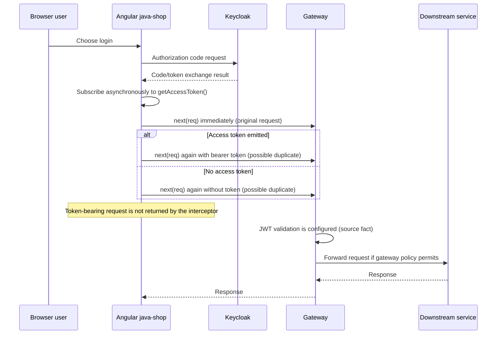

# Security review

[Back to the documentation hub](index.md) · [Back to the README](../README.md)

**Source baseline:** branch `feature/kubernetes`, HEAD `b3dafa4416ca12a90ae7cfd5249b166c42321799` (`b3dafa4`), dated 2025-01-17.  
**Documentation state:** `README.md` and `docs/**` are current uncommitted working-tree changes from this pass.  
**Analysis date:** 2026-09-01.  
**Review type:** static security review; no exploit attempts, runtime scans, or secret values are included. No pre-existing project-local docs directory was found before this pass.

## Threat surface

The repository exposes or configures these boundaries:

- Browser to Angular application.
- Browser to Keycloak using OpenID Connect (OIDC).
- Browser to gateway over HTTP.
- Gateway to product, order, and inventory services.
- Order service to inventory over HTTP.
- Order service to Kafka and Schema Registry.
- Notification service to Kafka and SMTP.
- Service logs and traces to Loki and Tempo.
- Local host ports for databases, administrative UIs, Keycloak, Kafka, and observability tools.
- Kubernetes Services, ConfigMaps, Secrets, images, and persistent volumes.

## Controls and effectiveness boundaries

### Configuration declarations

The following settings and declarations are visible in source/configuration:

- Gateway JWT resource-server configuration uses an issuer URI: `api-gateway/src/main/java/com/js/gateway/infra/security/SecurityConfig.java` and `src/main/resources/application.yml`.
- Gateway security configuration declares authentication for paths not included in its free-resource list.
- Gateway configuration declares CORS methods, allowed origins, allowed headers, and disabled credentials.
- The primary Angular app configuration declares authorization-code flow and an OIDC client library.
- Backend DTOs declare some Bean Validation annotations, including `@NotBlank`, `@NotNull`, and `@Email`. `PlaceOrderDTO.userDetails` has `@NotNull`, while no `@Valid` cascade was evidenced on that nested property.
- Order-to-inventory calls have a three-second connect/read timeout declaration plus separate Resilience4j circuit-breaker and retry annotations. Gateway circuit-breaker filters are a separate declaration; gateway retry behavior is not inferred from retry configuration alone.
- Dockerfiles use separate Maven builder and Temurin JRE stages for backend services.
- The repository ignores several `.env` files and Kubernetes Secret/ConfigMap paths through `.gitignore`.

### Effective-control assessment

Configuration and source declarations do not prove correct deployment, complete coverage, or resistance to attack. In particular:

- The primary Angular interceptor subscribes to `getAccessToken()` asynchronously, calls `next(req)` immediately outside the subscription, and calls `next(...)` again inside the subscription. The second call may carry the token or the original request when no token is available, so duplicate requests are possible. The interceptor does not return the token-bearing request from the subscription; effective bearer-header forwarding is therefore unverified.
- The gateway's JWT configuration is not proof of an effective end-to-end authentication or authorization control. Directly published service ports and missing downstream security declarations remain concerns.
- Nested DTO constraints are declarations, not proven request enforcement without an evidenced `@Valid` cascade.

## High-priority static risks

### 1. Secrets and defaults in configuration artifacts — High

Evidence includes:

- Root and service environment files and examples under `.env*`.
- Hardcoded database credentials in `order-service/src/main/resources/application.yml`.
- Kubernetes Secret manifests under `k8s/manifest/**/secrets*.yml` containing default or encoded values.
- Keycloak realm/configuration artifacts under `docker/keycloak/realms/` and `main-realm-export.json`.
- Example configuration that enables anonymous Grafana administration.

**Impact:** credentials can be copied into shared environments, logs, images, or source history. Base64 encoding in Kubernetes `data` is not encryption.

**Priority remediation:** rotate any exposed values; remove credentials from tracked artifacts; use a secret manager or CI/Kubernetes secret injection; restrict repository access; scan history; separate safe examples from deployable configuration.

### 2. Gateway-only authentication with directly published services — High

The gateway has a security filter chain, but local Compose maps product, order, and inventory ports directly. The inspected downstream services do not declare equivalent security filters. This creates a potential bypass of the intended gateway policy if those ports are reachable from an untrusted network.

**Impact:** direct calls may avoid gateway authentication, CORS, and gateway policy. Runtime exposure is not verified.

**Priority remediation:** bind internal services to private networks, remove unnecessary host port mappings, enforce service-to-service authentication, and add authorization tests for every exposed route.

### 3. Client-trusted price and identity data — High

`frontend/java-shop/src/app/pages/home-page/home-page.component.ts` sends product price and OIDC-derived user details in the order body. `PlaceOrderDTO` accepts both. `CreateOrderUseCaseImpl` calculates the total from the request price and quantity.

**Impact:** a client can submit a different price or user details unless another control not found in the inspected source rejects them.

**Priority remediation:** load price from the product service by SKU, derive identity from the verified token subject/claims, reject mismatches, and test tampering cases.

### 4. HTML interpolation of event/user data — High

`notification-service/src/main/java/com/js/microservices/notification/application/usecase/FormatMailBodyUseCaseImpl.java` inserts first name, last name, and order number into an HTML email template without visible escaping.

**Impact:** crafted values may alter email markup or create phishing/content injection risk. No exploitation was attempted.

**Priority remediation:** HTML-escape all dynamic values, validate expected formats, use a safe templating mechanism, and add tests for markup characters.

### 5. Incomplete order/event atomicity — High

`OrderServiceImpl` persists an order before `KafkaOrderProducer` calls `kafka.send`. The send result is not inspected. No outbox, idempotency key, duplicate handling, or explicit recovery path was found.

**Impact:** an order may be stored without a corresponding notification event, or a retried event may cause duplicate mail. The repository does not prove that either has happened.

**Priority remediation:** use a transactional outbox or coordinated event publication, persist event status, handle producer callbacks, define retry/DLQ policy, and make notification handling idempotent.

## Medium-priority static risks

- **Stock race condition:** inventory is checked with a read-only existence query; no reservation/decrement is performed. Concurrent orders can observe the same stock.
- **Missing numeric validation:** product price and order quantity have null/nonblank checks but no positive, range, scale, or maximum constraints in the inspected DTOs.
- **Broad management exposure:** several configurations expose `*` actuator endpoints and show health details always. Gateway permits Prometheus and documentation paths.
- **Wildcard CORS and web origins:** example and realm configuration use broad origins. Restrict origins to known environments.
- **Mutable images:** Compose, Testcontainers, and Kubernetes use multiple `latest` tags; CI pushes `latest`. This weakens provenance and rollback.
- **Operational UIs and data ports:** Compose publishes database consoles, databases, Kafka, Keycloak, Grafana, and metrics ports for local use. Do not expose them beyond an isolated development network.
- **Logging of sensitive context:** source logs DTOs and operational details. Review whether tokens, personal data, or mail recipients can enter logs through future changes.
- **Transport assumptions:** many local URLs use HTTP and plaintext Kafka. Treat them as isolated development declarations only.

## Authentication flow

### Numbered security-flow equivalent

| # | Actor | Success branch | Failure branch or limit |
|---:|---|---|---|
| 1 | User → UI | User starts login in the primary Angular application. | The SSR scaffold is separate and contains placeholder authentication settings. |
| 2 | UI → Keycloak | UI requests an authorization code and exchanges it for token state. | Keycloak reachability, redirect alignment, and token exchange were not runtime-verified. |
| 3 | UI interceptor | A correctly implemented interceptor would return one request carrying the bearer token. | The inspected interceptor subscribes asynchronously, calls `next(req)` immediately and `next(...)` again inside the subscription, may produce duplicate requests, and does not return the token-bearing request. |
| 4 | UI → Gateway | The gateway source configuration declares JWT resource-server validation using the configured issuer URI. | The immediate request may lack a token; effective header forwarding, missing/invalid token handling, and issuer alignment were not exercised. |
| 5 | Gateway → service | Gateway forwards an allowed request to product, order, or inventory. | Downstream services have no evidenced local `SecurityFilterChain`; direct published ports may bypass gateway policy. |
| 6 | Service → UI | Service response returns through gateway to the UI. | Authorization completeness, error payloads, and runtime exposure remain unverified. |

**Security limit:** the configuration facts above must not be read as effective-control or runtime-success claims. Downstream authorization enforcement is not evidenced in the inspected service source, and the gateway's authentication policy must not be treated as complete service authorization.

## Data and secrets handling

- Do not document or commit live `.env` values, SMTP passwords, database passwords, Keycloak administrator credentials, client secrets, or realm export secrets.
- Treat email addresses, names, order numbers, and trace/log payloads as personal or operational data.
- Restrict Grafana anonymous access and administrative role configuration outside isolated local development.
- Prefer least privilege for service accounts, database users, Kafka principals, and Kubernetes service accounts.
- Apply network policies and private service networking before sharing the topology.

## CI and validation caveat

The inventory workflow at `.github/workflows/inventory-service/ci.yml` has malformed job/steps structure: `steps` is at the workflow `jobs` level rather than nested under `ci_pipeline`. Its standalone `cd ./inventory-service/inventory-service` step also cannot persist its working directory to later steps. The order workflow has the analogous standalone `cd ./order-service` risk. These files are workflow declarations, not proof of a functioning security or quality gate.

## Security validation plan

1. Scan tracked history and current files for secrets, including encoded Kubernetes data.
2. Validate every Compose/Kubernetes manifest in a clean, isolated environment.
3. Test gateway and direct service ports for authentication and authorization parity.
4. Test invalid, expired, wrong-issuer, wrong-audience, and insufficient-role tokens.
5. Test request tampering for price, quantity, SKU, and user details.
6. Test HTML escaping with harmless markup characters in names/order identifiers.
7. Test duplicate Kafka delivery, producer failure after database commit, consumer failure, and SMTP failure.
8. Add dependency, container image, IaC, and CI security scanning with pinned action/image versions.
9. Define retention and redaction rules for logs, traces, email data, and database backups.

## Review boundaries

This page reports risks visible in repository artifacts. It does not assert a vulnerability was exploited, does not provide exploit instructions, and does not replace a runtime penetration test, dependency audit, threat model workshop, or security sign-off.
